# Лабораторная работа №1 — контейнеризация: внутренности Docker

## Часть 1. Запусти напрямую

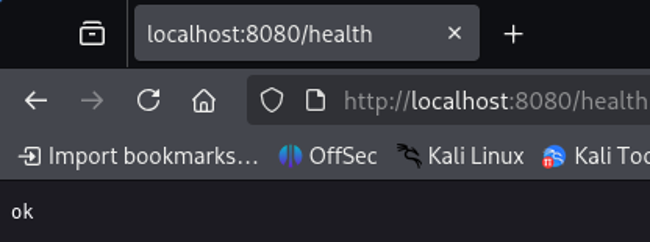

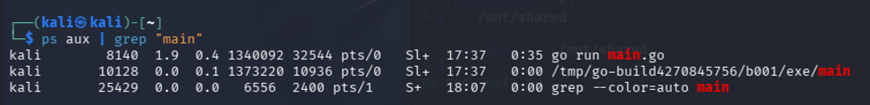

## Часть 2. Namespaces

PID процесса в примерах ниже — `10128` (может меняться).

### PID namespace

```bash
sudo unshare --pid --fork --mount-proc bash
```

Смотрим PID процесса:

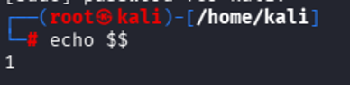
 
Видим, что ID процесса стал единицей. Дополнительно смотрим список всех процессов.

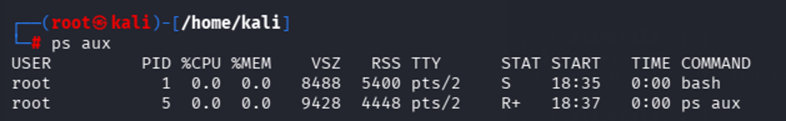

### UTS namespace

```bash
sudo unshare --uts --fork bash
```

Меняем имя хоста:

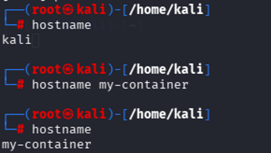
 
Замечаем, что в другой оболочке имя осталось прежним:

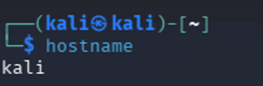

### Mount namespace

```bash
sudo unshare --mount --fork bash
```
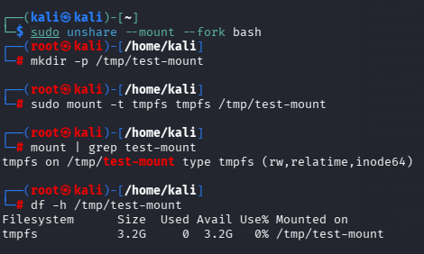

Проверяем в другой оболочке:

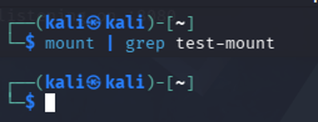


### Net namespace

```bash
sudo unshare --net bash
```
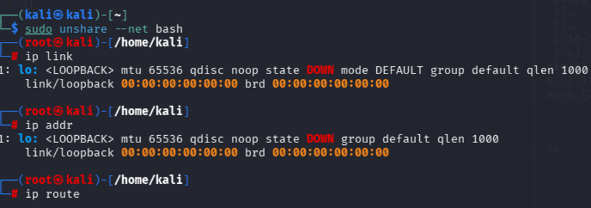

На хосте:

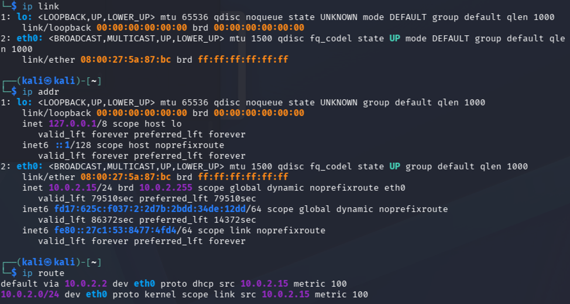


Видно, что в новом неймспейсе нет никаких других интерфейсов и адресов, кроме loopback, а таблица маршрутизации пуста. Для демонстрации проверяем связность оболочки с интернетом (например, с DNS-сервером Google):

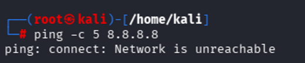


Видим, что связи нет (логично: нет ни IP, ни даже канальной связности с чем-либо). Стоит отметить: даже если внутри net namespace настроить интерфейс, IP-адрес, маршрут по умолчанию и DNS — этого всё равно не хватит для доступа в интернет, потому что у namespace нет физического выхода наружу. Придётся дополнительно настраивать veth-пару, где один конец будет в созданном неймспейсе, а другой — в хостовом.

### IPC namespace

```bash
sudo unshare --ipc bash
```

Результат:

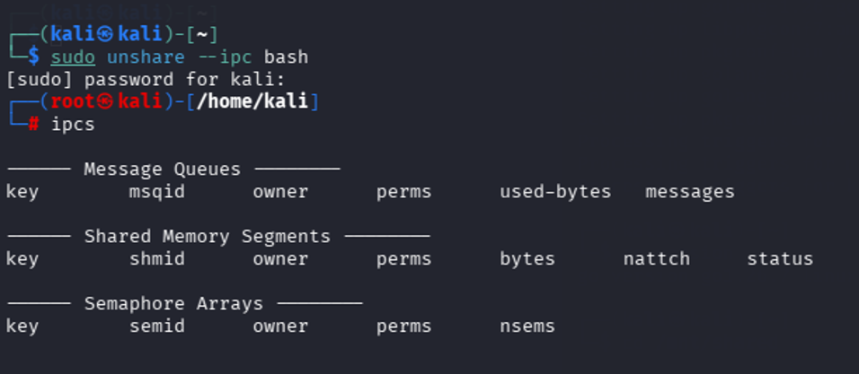


На хосте:

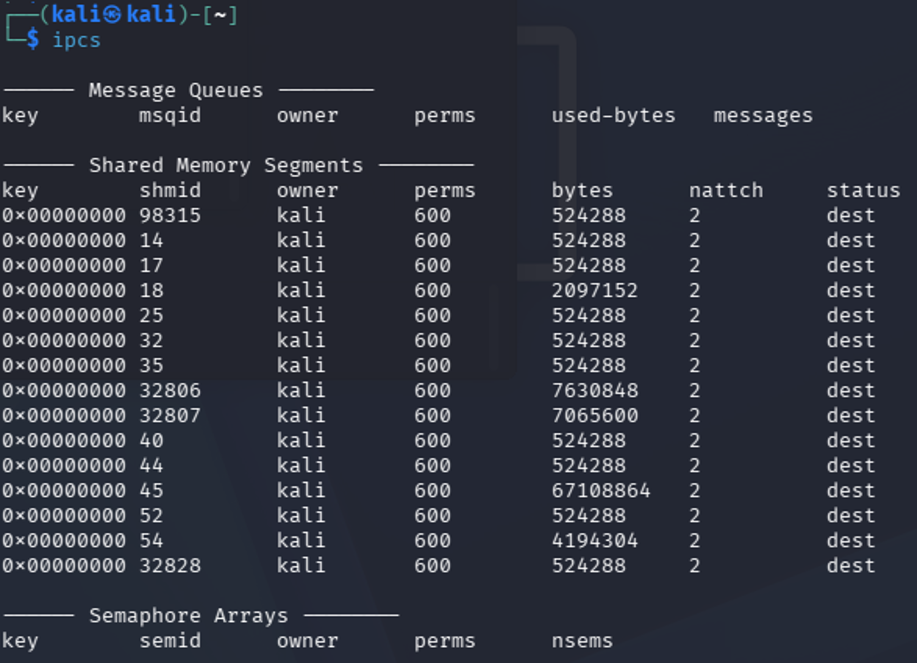

### User namespace

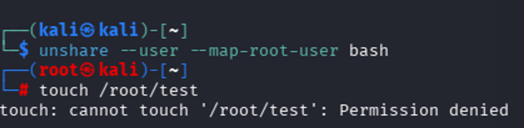

На хосте:

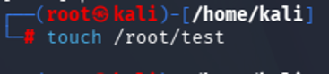


## Часть 3. Cgroups

### Ограничение на потребление памяти

```bash
sudo mkdir /sys/fs/cgroup/lab-api
echo 100M | sudo tee /sys/fs/cgroup/lab-api/memory.max
```

Проверка:

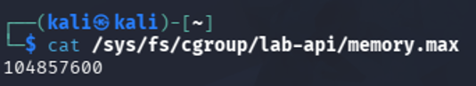

Кладём процесс в контрольную группу:

```bash
echo 5661 | sudo tee /sys/fs/cgroup/lab-api/cgroup.procs
```

Видим, что пока событий OOMKilled нет:

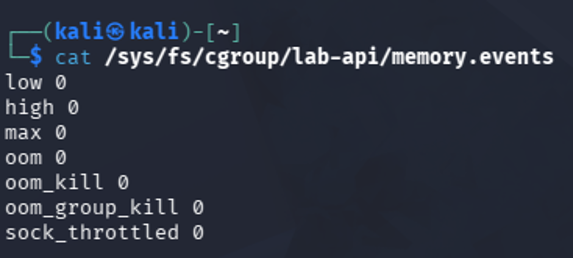


Выделяем неприлично много памяти:


Результат:

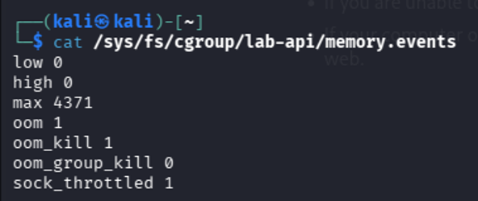


Методом научного тыка было выяснено, что при указанном лимите в 100 МиБ процесс по неизвестной причине убивается только после выделения 400+ МБ.


### Ограничения на использование процессора

```bash
echo "50000 100000" | sudo tee /sys/fs/cgroup/lab-api/cpu.max
```

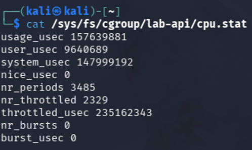

Видно большое количество троттлингов.


### Ограничение на количество процессов

```bash
echo 30 | sudo tee /sys/fs/cgroup/lab-api/pids.max
```


Проверка:

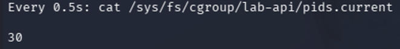

 Запускаем форк-бомбу:

```bash
stress-ng --fork 100 --timeout 10s &
echo $! | sudo tee /sys/fs/cgroup/lab-api/cgroup.procs
```

Проверка:


```bash
watch -n 0.5 cat /sys/fs/cgroup/lab-api/pids.current
```

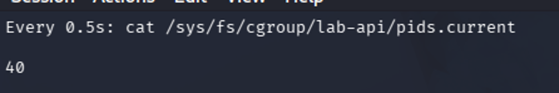

Видно, что при запуске бомбы количество процессов сразу доходит до лимита, но дальше не растёт.


## Часть 4. Capabilities и seccomp

Сбрасываем лишние capabilities (для удобства проверки запущен bash, а не сервис):

```bash
sudo capsh --drop=all -- -c "/bin/bash"
```

Проверка:

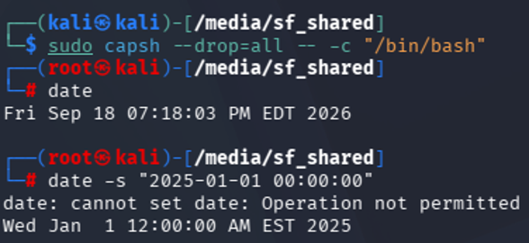


Seccomp-профиль:

```json
{
  "defaultAction": "SCMP_ACT_ALLOW",
  "syscalls": [
    {
      "names": ["settimeofday"],
      "action": "SCMP_ACT_ERRNO"
    }
  ]
}
```

Проверка:

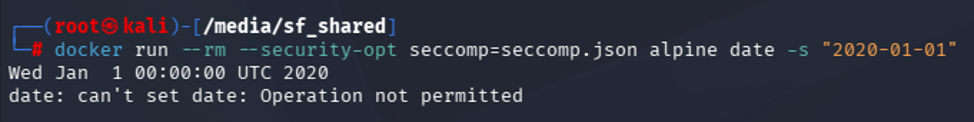


## Часть 5. Свой контейнер: скрипт и сравнение с Docker

Соберём всё сделанное ранее в скрипт `mydocker.sh`:

```bash
#!/bin/bash
sudo ip link delete veth-host 2>/dev/null || true
CGNAME="mydocker-$$"
sudo mkdir -p /sys/fs/cgroup/$CGNAME
echo 100M | sudo tee /sys/fs/cgroup/$CGNAME/memory.max
echo "50000 100000" | sudo tee /sys/fs/cgroup/$CGNAME/cpu.max
echo 30 | sudo tee /sys/fs/cgroup/$CGNAME/pids.max
(
    MYPID=$BASHPID
    echo $MYPID | sudo tee /sys/fs/cgroup/$CGNAME/cgroup.procs > /dev/null
    exec unshare --pid --fork --mount --mount-proc --uts --ipc --net --user --map-root-user --cgroup \
      -- sh -c 'ip link set lo up && capsh --drop=all -- -c "./seccomp ./api"'
) &
APP_PID=$!
sleep 1
sudo ip link add veth-host type veth peer name veth-cont
sudo ip link set veth-cont netns $APP_PID
sudo ip addr add 10.0.0.1/24 dev veth-host
sudo ip link set veth-host up
sudo nsenter -t $APP_PID -n ip addr add 10.0.0.2/24 dev veth-cont
sudo nsenter -t $APP_PID -n ip link set veth-cont up
wait $APP_PID
sudo ip link delete veth-host
sudo rmdir /sys/fs/cgroup/$CGNAME
```

В скрипте дополнительно создаётся veth-пара для того, чтобы процесс не был изолирован от локальной сети.

Seccomp-профиль навешивается на процесс через программу на C (`seccomp-run.c`):

```c
#include <errno.h>
#include <seccomp.h>
#include <stdio.h>
#include <stdlib.h>
#include <sys/prctl.h>
#include <unistd.h>

int main(int argc, char *argv[]) {
    scmp_filter_ctx filter;
    int result;

    if (argc < 2) {
        fprintf(stderr, "Usage: %s COMMAND [ARG...]\n", argv[0]);
        return EXIT_FAILURE;
    }

    if (prctl(PR_SET_NO_NEW_PRIVS, 1, 0, 0, 0) == -1) {
        perror("prctl(PR_SET_NO_NEW_PRIVS)");
        return EXIT_FAILURE;
    }

    filter = seccomp_init(SCMP_ACT_ALLOW);
    if (filter == NULL) {
        fputs("seccomp_init: could not create filter\n", stderr);
        return EXIT_FAILURE;
    }

    result = seccomp_rule_add(filter, SCMP_ACT_ERRNO(EPERM), SCMP_SYS(settimeofday), 0);
    if (result < 0) {
        seccomp_release(filter);
        fprintf(stderr, "seccomp_rule_add failed: %d\n", result);
        return EXIT_FAILURE;
    }

    result = seccomp_load(filter);
    seccomp_release(filter);
    if (result < 0) {
        fprintf(stderr, "seccomp_load failed: %d\n", result);
        return EXIT_FAILURE;
    }

    execvp(argv[1], &argv[1]);
    perror("execvp");
    return EXIT_FAILURE;
}
```

Теперь запустим docker-контейнер с теми же ограничениями, что и в скрипте:

```bash
docker run -d --name test-api \
  --memory=100m \
  --cpus=0.5 \
  --pids-limit=30 \
  --cap-drop=ALL \
  --security-opt no-new-privileges \
  myapi
```

Сравним деятельность созданного скрипта с тем, что делает Docker:

| Параметр | Скрипт | Docker |
|---|---|---|
| Namespaces | pid, mount, uts, ipc, net, user | pid, mount, uts, ipc, net |
| Cgroups и лимиты | создал группу вручную | создаёт через systemd |
| Привилегии | `capsh --drop=all` + seccomp | `--cap-drop=ALL` (по умолчанию — стандартный набор) |
| Сеть | ручная veth `10.0.0.1 ↔ 10.0.0.2` | bridge `docker0`, IP из `172.17.0.0/16` |
| Образ | нет образа, использует ФС хоста | образ со слоями (overlay2) |
| Логирование | терминал (stdout) | `docker logs` |
| Перезапуск при падении | нет | есть через флаг `--restart` |

## Часть 6. Образы, слои и данные

### Multi-stage сборка

Создаём Dockerfile для multi-stage сборки:

```dockerfile
FROM golang:1.26 AS builder
WORKDIR /build
COPY go.mod main.go ./
RUN CGO_ENABLED=0 go build -o api .

FROM debian:bookworm-slim
WORKDIR /app
COPY --from=builder /build/api .
EXPOSE 8080
CMD ["./api"]
```

После сборки образов сравним их по размеру:

Видно, что итоговый размер базового образа примерно в 12 раз больше, чем multi-stage, потому что туда включён компилятор и зависимости.

### Том: данные переживают контейнер

Создаём именованный том, записываем в него данные из одного контейнера, удаляем контейнер и читаем данные из нового:

```bash
docker volume create lab1-api-data

docker run -d --rm --name api-volume \
  -v lab1-api-data:/data \
  lab1-api:baseline
docker exec api-volume sh -c 'echo persistent > /data/state.txt'
docker stop api-volume

docker run -d --rm --name api-volume \
  -v lab1-api-data:/data \
  lab1-api:baseline
docker exec api-volume cat /data/state.txt
docker stop api-volume

sudo cat /var/lib/docker/volumes/lab1-api-data/_data/state.txt
```

Вывод:


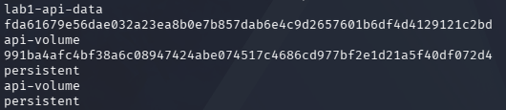

Видим, что том был создан. Затем первый контейнер записал `persistent` в `/data`. Далее первый контейнер остановлен и удалён. Потом второй контейнер читает `persistent` — данные пережили смерть первого контейнера. В последней строке видно, что файл лежит на хосте.

### Writable-слой: данные умирают вместе с контейнером

Теперь по такому же сценарию пишем данные не в том, а напрямую в образ:

```bash
docker run -d --rm --name api-ephemeral lab1-api:baseline
docker exec api-ephemeral sh -c 'echo transient > /app/state.txt'
docker exec api-ephemeral cat /app/state.txt
docker stop api-ephemeral

docker run -d --rm --name api-ephemeral lab1-api:baseline
docker exec api-ephemeral test ! -e /app/state.txt && echo "file disappeared"
docker stop api-ephemeral
```

Результат:

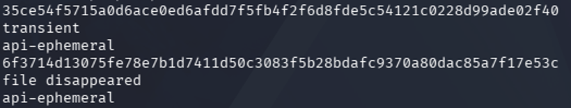


Видим, что первый контейнер записал `transient` в `/app/state.txt`. Затем этот файл читается, пока контейнер жив. После этого контейнер удаляется и запускается второй контейнер. Видно, что файла уже нет, потому что второй контейнер стартовал из тех же read-only слоёв образа, и никакого `state.txt` там никогда не было.

## Часть 7. gVisor: когда контейнера недостаточно

Установим gVisor:

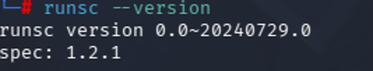

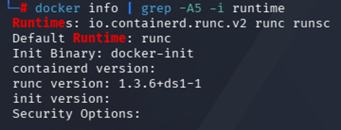


Видим, что можно запустить контейнер через флаг `--runtime=runsc`. Запускаем:

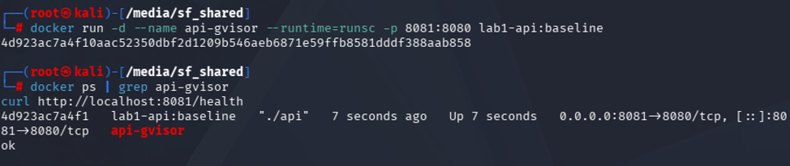


Сравним, что видит процесс внутри обычного контейнера и внутри gVisor:

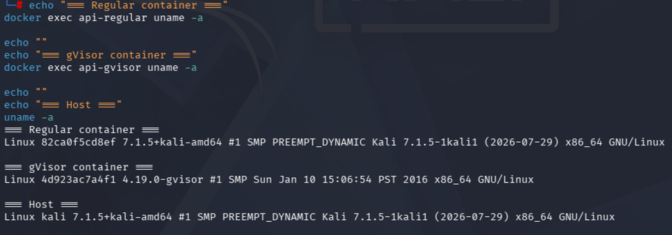


Обычный контейнер видит то же самое ядро, что и хост — та же версия, тот же билд, та же дата сборки. Потому что это и есть одно ядро на всех.

В gVisor — версия `4.19.0-gvisor` со сборкой от 2016 года, хотя на хосте стоит ядро 2026 года. Это не случайность и не баг — это эмулированное ядро, которое Sentry показывает процессам внутри песочницы. Оно не имеет никакого отношения к реальному ядру хоста.

## Часть 8. Мониторинг

Установим cAdvisor. Потом создадим prometheus.yml:
 
```yaml
global:
  scrape_interval: 15s

scrape_configs:
  - job_name: 'cadvisor'
    static_configs:
      - targets: ['cadvisor:8080']
```
Затем создадим сетевой неймспейс для мониторинга и запустим Prometheus и Grafana:
```bash
docker network create monitoring

docker run -d \
  --name prometheus \
--user root \
  --network monitoring \
  -p 9090:9090 \
  -v /tmp/prometheus.yml:/etc/prometheus/prometheus.yml \
  prom/prometheus

docker run -d \
  --name grafana \
  --network monitoring \
  -p 3000:3000 \
  grafana/grafana
```
Выбранные метрики:
1.	CPU
GraphQL: rate(container_cpu_usage_seconds_total{name="api-mon", cpu="total"}[1m])
Выбрана, потому что важно мониторить нагрузку процессора 
2.	Memory
GraphQL: container_memory_working_set_bytes{name="api-mon"}
Выбрана для ловли OOM
3.	Trottling
GraphQL: 100 * rate(container_cpu_cfs_throttled_periods_total{name="api-mon"}[1m])
    / rate(container_cpu_cfs_periods_total{name="api-mon"}[1m])
Выбрана для понимания, сколько времени ядро тормозило процессор

Запустим подопытный контейнер:
```bash
docker run -d --name api-mon --cpus=0.2 --memory=100m -p 8081:8080 lab1-api:baseline
```

Собранный дашборд:

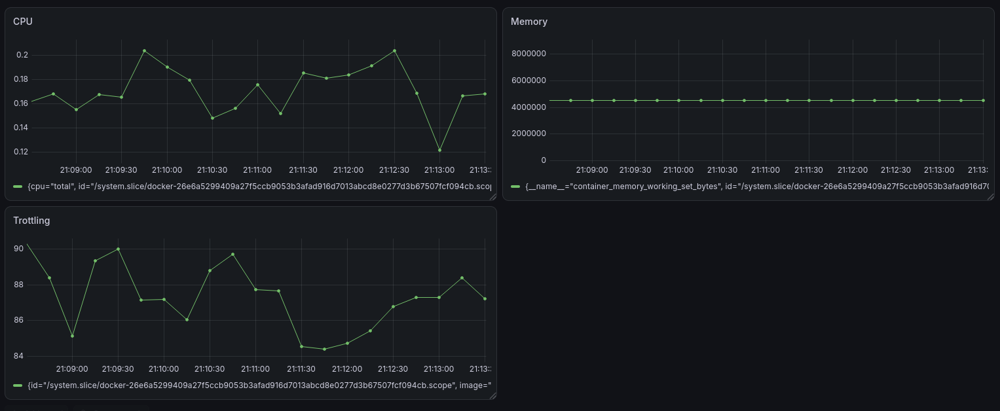