# Лабораторная работа №2: Контейнеризация и оркестрация

## Часть 0. Подготовка окружения и запуск сервиса

Цель части — поднять Kubernetes-кластер и разместить в нём подопытный сервис `lab2-api`, собранный из собственного Helm-чарта.

### Запуск кластера k3s

```bash
sudo systemctl start k3s
sudo systemctl status k3s --no-pager
```

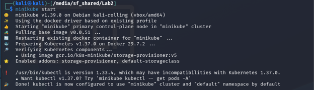

### Проверка работоспособности сервиса
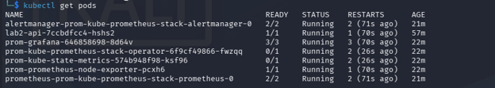

Пробрасываем порт на сервис:

```bash
kubectl port-forward svc/lab2-api 8080:8080 &
curl http://localhost:8080/health
```

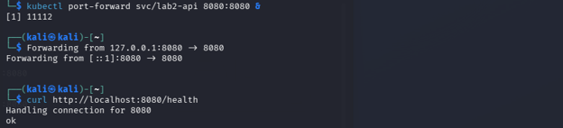

---

## Часть 1. Метрики: Prometheus + Grafana


### Установка стека через Helm

```bash
helm repo add prometheus-community https://prometheus-community.github.io/helm-charts
helm repo update
helm install prom prometheus-community/kube-prometheus-stack
```

Проверяем:

```bash
kubectl get pods -l release=prom
```


### Подключение сервиса к мониторингу

Создаём объект `ServiceMonitor`, который указывает Prometheus, какой эндпоинт скрейпить. Проверяем, что он принят оператором:

```bash
kubectl get servicemonitor lab2-api
```

### Проброс портов и вход в Grafana

```bash
kubectl port-forward svc/prom-kube-prometheus-stack-prometheus 9090:9090 &
kubectl port-forward svc/prom-grafana 3000:80 &
```

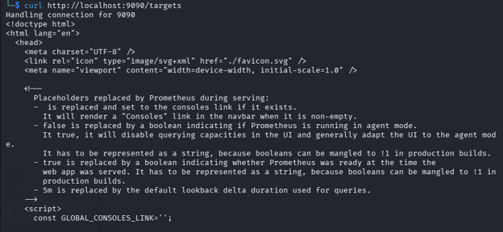
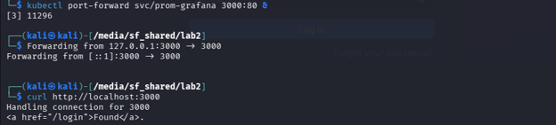

Логин `admin`, пароль получаем из секрета:

```bash
kubectl get secret --namespace default prom-grafana \
  -o jsonpath="{.data.admin-password}" | base64 --decode ; echo
```

### Создание RED-дашборда

В Grafana: **New dashboard → Add new panel → Edit visualization**. Источник данных — Prometheus, режим запроса — **Code**.

**Панель 1 — Request Rate (RPS):**

```promql
sum(rate(http_requests_total[5m])) by (endpoint)
```

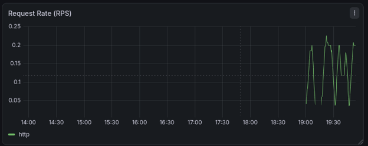


**Панель 2 — Error Rate:**

```promql
sum(rate(http_requests_total{status=~"5.."}[5m])) by (endpoint)
```
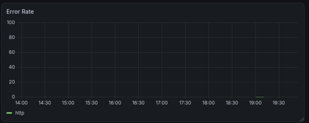

**Панель 3 — p95 latency:**

```promql
histogram_quantile(0.95,
  sum(rate(http_request_duration_seconds_bucket[5m])) by (le, endpoint)
)
```
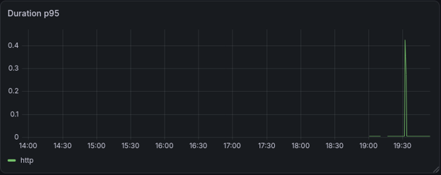

Итоговый дашборд после GET-запросов по разным маршрутам (`/health`, `/fail`, `/slow`):

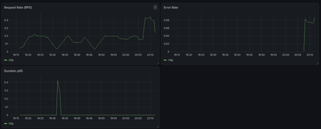

> **Примечание.** В начале выполнения Части 2 Minikube начал пожирать весь процессор независимо от количества выделенных ядер, из-за чего виртуальная машина намертво зависала. Поэтому я перешел на k3s. Принципиально в архитектуре стека ничего не изменилось, скриншоты Части 1 остались теми же.

---

## Часть 2. Логи: Loki + Promtail


### Установка Loki

Файл `loki-values.yaml`:

```yaml
deploymentMode: SingleBinary
singleBinary:
  replicas: 1
  persistence:
    enabled: true
write:
  replicas: 0
read:
  replicas: 0
backend:
  replicas: 0
loki:
  auth_enabled: false
  commonConfig:
    replication_factor: 1
  storage:
    type: filesystem
    object_store: filesystem
  schemaConfig:
    configs:
      - from: "2024-04-01"
        store: tsdb
        schema: v13
        index:
          prefix: index_
          period: 24h
```

Установка:

```bash
helm install loki grafana/loki -f loki-values.yaml
```

### Установка Promtail

Файл `promtail-values.yaml`:

```yaml
config:
  clients:
    - url: http://loki:3100/loki/api/v1/push
  snippets:
    extraRelabelConfigs:
      - source_labels: [__meta_kubernetes_pod_label_app_kubernetes_io_name]
        action: keep
        regex: lab2-api
    pipelineStages:
      - cri: {}
      - json:
          expressions:
            level: level
            endpoint: endpoint
            status: status
            trace_id: trace_id
      - labels:
          level:
          endpoint:
          status:
```

Установка:

```bash
helm install promtail grafana/promtail -f promtail-values.yaml
```

Promtail разворачивается как DaemonSet — по одному агенту на каждой ноде, потому что stdout контейнеров физически лежит на диске конкретной ноды, и читать его должен соседний процесс.

### Применение обновлённых values к Grafana

Добавляем Loki как источник данных через ConfigMap с лейблом `grafana_datasource: "1"` (sidecar-вотчер в поде Grafana подхватывает такие ConfigMap'ы автоматически):

```bash
helm upgrade prom prometheus-community/kube-prometheus-stack -f values.yaml
```

### Проверка: поиск ошибок в логах

В Grafana → **Explore** → источник **Loki**, режим **Code**:

```logql
{app="lab2-api"} |= "fail"
```

Результат:

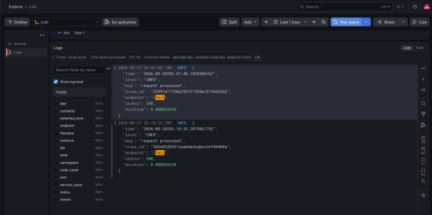

---

## Часть 3. Трейсы: Jaeger + OpenTelemetry


### Установка Jaeger

Jaeger v2 построен на OpenTelemetry Collector и по умолчанию работает в режиме All-in-One (один деплой, память как хранилище):

```bash
cd /media/sf_shared/Lab2/monitoring
helm install jaeger jaegertracing/jaeger
sleep 5
kubectl get pods | grep -i jaeger
kubectl get svc -o wide | grep -i jaeger
```

Сервис получает имя `jaeger` и открывает порты `4318` (OTLP/HTTP) и `16686` (UI).

### Исправление адреса экспорта в приложении

Правим адрес в `values.yaml` чарта приложения:

```bash
cd /media/sf_shared
f=$(grep -rl 'jaeger-collector' lab2-chart Lab2 2>/dev/null | head -1)
chart=$(dirname "$f")
sed -i 's|http://jaeger-collector:4318|http://jaeger:4318|g' "$f"
grep -n 'jaeger' "$f"
helm upgrade lab2-api "$chart"
```

### Просмотр трейсов в Jaeger UI

```bash
kubectl port-forward svc/jaeger 16686:16686 &
```

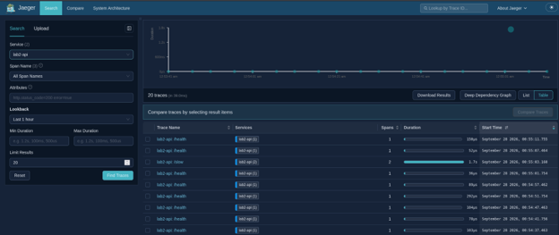

Генерируем нагрузку и находим трейсы:

```bash
curl http://localhost:8080/slow
curl http://localhost:8080/fail
```


Трейс `/slow` — два вложенных спана (`Depth: 2`), внешний длится ~1.7s, внутренний `slow-op` занимает почти всё время:

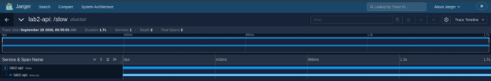


Трейс `/fail` отображается красным (span marked as error):

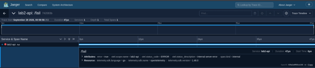

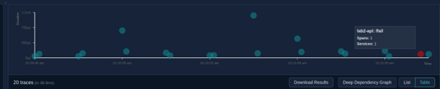


### Связка лог → трейс по trace_id

Берём `trace_id` из строки лога в Grafana (Explore → Loki), вставляем в поле **Lookup by Trace ID** в Jaeger UI — открывается тот самый трейс:

```
http://localhost:16686/trace/<trace_id_из_лога>
```

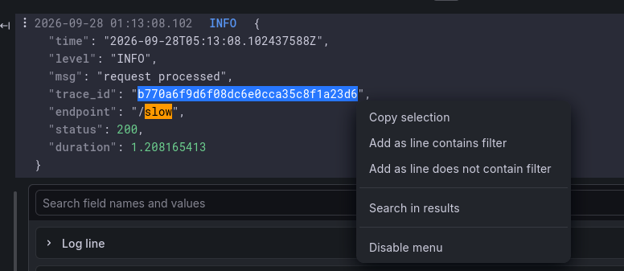

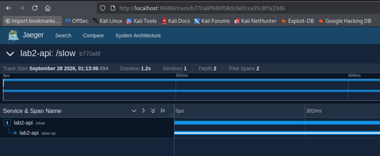


Это доказательство того, что вся цепочка Promtail → Loki → Grafana → Jaeger собрана корректно: один и тот же идентификатор связывает текстовый лог и дерево спанов.

---

## Часть 4. Алертинг: Alertmanager + Karma

Alertmanager уже стоит, нужно добавить собственные правила алертов и поставить Karma.

### Правила алертов (RED + availability)

Переписываем `monitoring/values.yaml`, добавляя блок `additionalPrometheusRulesMap`:

```yaml
grafana:
  additionalDataSources:
    - name: Loki
      type: loki
      access: proxy
      url: http://loki:3100
      uid: loki
      isDefault: false
      editable: false

additionalPrometheusRulesMap:
  lab2-alerts:
    groups:
      - name: lab2.rules
        rules:
          - alert: HighErrorRate
            expr: |
              sum(rate(http_requests_total{job="lab2-api", status=~"5.."}[1m]))
                /
              sum(rate(http_requests_total{job="lab2-api"}[1m]))
                > 0.05
            for: 1m
            labels:
              severity: critical
            annotations:
              summary: "Высокий error rate у lab2-api (>5%)"
              description: "Доля 5xx ответов {{ $value | humanizePercentage }} за последние 1 мин."

          - alert: HighLatencyP95
            expr: |
              histogram_quantile(0.95,
                sum by (le) (rate(http_request_duration_seconds_bucket{job="lab2-api"}[2m]))
              ) > 1
            for: 2m
            labels:
              severity: warning
            annotations:
              summary: "Высокая p95 латентность у lab2-api (>1s)"
              description: "p95 = {{ $value }}s за последние 2 мин."

          - alert: ServiceDown
            expr: |
              absent(up{job="lab2-api"} == 1)
            for: 1m
            labels:
              severity: critical
            annotations:
              summary: "lab2-api недоступен"
              description: "Нет успешных скрейпов метрик сервиса более 1 мин."
```

Применяем правила:

```bash
helm upgrade prom prometheus-community/kube-prometheus-stack -f values.yaml
kubectl get prometheusrule | grep lab2-alerts
```

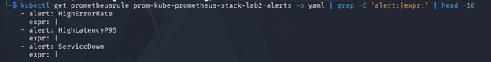

Prometheus Operator автоматически подхватывает все объекты `PrometheusRule` в namespace, отдельная регистрация не нужна.

### Установка Karma

Karma — веб-интерфейс поверх Alertmanager с группировкой, фильтрами и удобной историей. Адрес Alertmanager передаётся переменной окружения:

```bash
helm repo add karma-wiremind https://wiremind.github.io/wiremind-helm-charts
helm repo update
helm install karma karma-wiremind/karma \
  --set env[0].name=ALERTMANAGER_URI \
  --set env[0].value=http://prom-kube-prometheus-stack-alertmanager:9093
```

### Проброс портов

```bash
kubectl port-forward svc/karma 8081:80 &
kubectl port-forward svc/prom-kube-prometheus-stack-alertmanager 9093:9093 &
```

Открываем `http://localhost:8081` — видим стартовые системные алерты k3s:

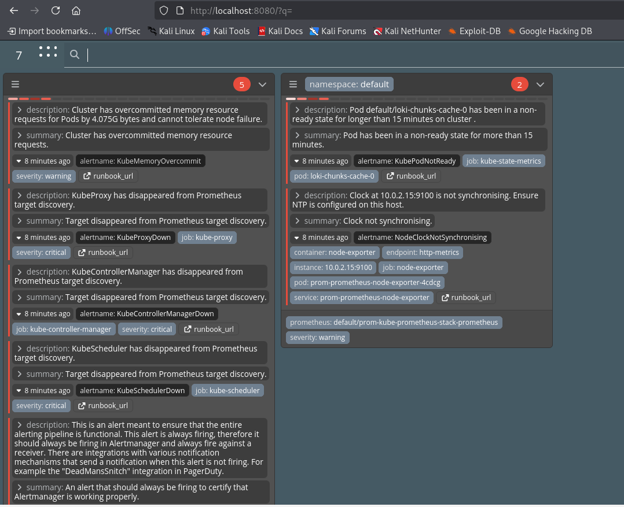


### Генерация нагрузки и проверка срабатывания

Долбим `/fail` дольше окна `for: 1m`, чтобы гарантированно перевести долю 5xx выше порога 5% непрерывно:

```bash
start_time=$(date +%s)
while [ $(($(date +%s) - start_time)) -lt 120 ]; do
  curl -s http://localhost:8080/fail >/dev/null &
  sleep 0.2
done
wait
```

Через пару минут в Karma появляется карточка **HighErrorRate**:

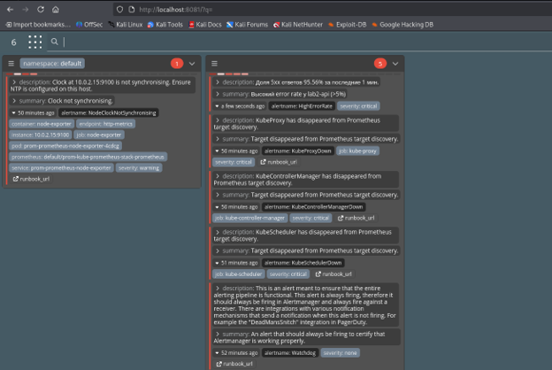

Это подтверждает работу всей цепочки: Prometheus оценивает правило → отправляет firing в Alertmanager → Alertmanager группирует → Karma показывает.
