# Лабораторная работа 3 — Платформа для shop

## Часть 1. Guardrails для кластера (Kyverno)

Для использования в работе выбран движок **Kyverno**, потому что политики пишутся на **YAML**, а не на специальном языке.

```bash
helm repo add kyverno https://kyverno.github.io/kyverno/
helm repo update
helm install kyverno kyverno/kyverno -n kyverno --create-namespace
```
Проверка:

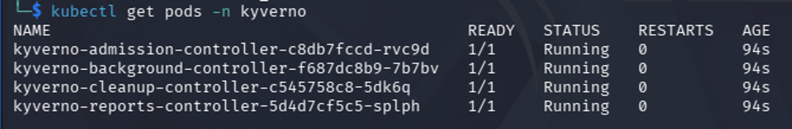
### Первая политика

```yaml
apiVersion: kyverno.io/v1
kind: ClusterPolicy
metadata:
  name: require-limits
  annotations:
    policies.kyverno.io/title: Require resource limits
    policies.kyverno.io/description: >-
      Каждый контейнер обязан указать limits по памяти и CPU.
      Без лимитов под может сожрать всю ноду и уронить соседей.
spec:
  validationFailureAction: Enforce   # Enforce = отклонять, Audit = только логировать
  background: true
  rules:
  - name: check-limits
    match:
      any:
      - resources:
          kinds:
          - Pod
    validate:
      message: "У контейнера должны быть заданы resources.limits.memory и resources.limits.cpu"
      pattern:
        spec:
          containers:
          - resources:
              limits:
                memory: "?*"
                cpu: "?*"
```

Применяем и проверяем:

```bash
kubectl apply -f policies/require-limits.yaml
kubectl get clusterpolicy
```
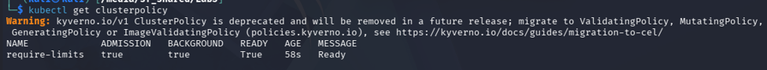

### Пять политик и пять «плохих» манифестов

Созданы пять политик:

1. требование `resources.limits.memory` и `resources.limits.cpu` для контейнера;
2. запрет привилегированных контейнеров;
3. требование обязательных лейблов `app` и `version`;
4. образы только из `docker.io`, `gcr.io`, `ghcr.io`;
5. запрет запуска контейнеров от рута.

Также созданы пять плохих манифестов для их проверки.

Применяем политики:


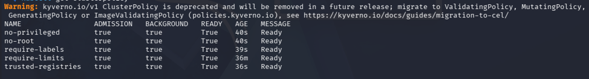

Проверяем, отобьёт ли Kyverno плохие манифесты:

- **Лимиты:**

![alt text]Screenshots/(image-4.png)
- **Привилегированный контейнер:**

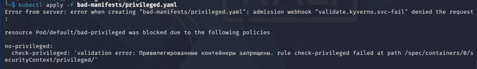
- **Отсутствие лейблов:**

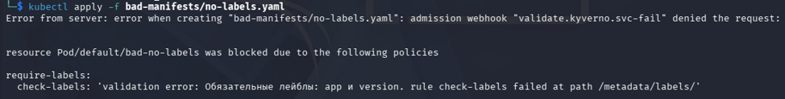
- **Недоверенный источник:**

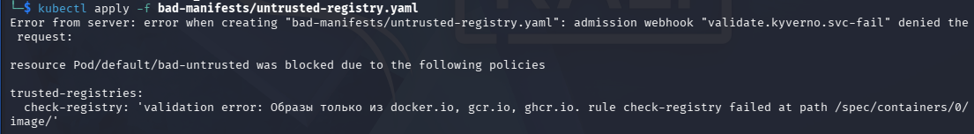
- **Контейнер-рут:**

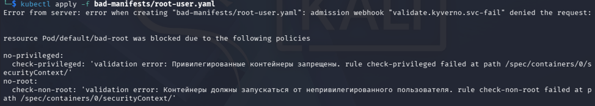

Проверяем хороший под:


Все плохие манифесты были отбиты, а хороший принят.

### Снижение нагрузки от Kyverno

Т.к. Kyverno начал жрать процессор, во всех политиках поле `background` поставлено в `false` и отключены контроллеры, отвечающие за проверку существующих объектов и написание отчётов на каждое событие:

```bash
kubectl scale --replicas=0 deployment/kyverno-background-controller deployment/kyverno-reports-controller -n kyverno
kubectl delete ur,polr,cpolr,ephr,cephr --all -A
```

## Часть 2. Helm-чарт для api и worker

Собираем образы с нужными тегами:

```bash
docker build -t docker.io/library/shop-api:v2 ./api
docker build -t docker.io/library/shop-worker:v2 ./worker
```

Экспортируем из docker в containerd:

```bash
docker save docker.io/library/shop-api:v2 -o api.tar
docker save docker.io/library/shop-worker:v2 -o worker.tar
sudo /usr/local/bin/k3s ctr images import api.tar
sudo /usr/local/bin/k3s ctr images import worker.tar
```

Добавляем `api-service.yaml`. Устанавливаем чарт:

```bash
helm install shop ./charts/shop
```

Видим три пода `api` и два пода `worker`:

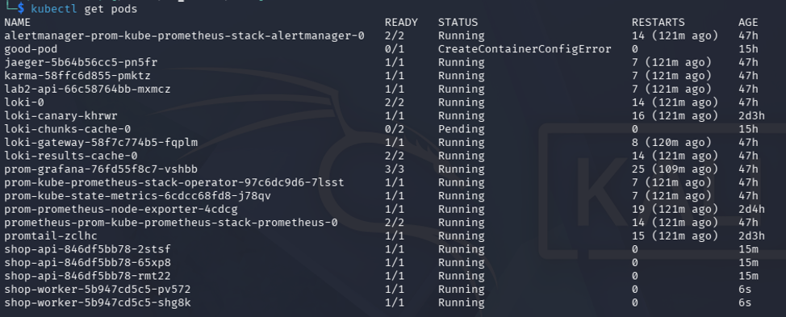

Также видим Service для `api`:

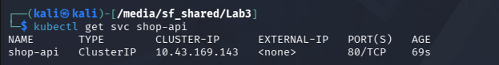

### Reconciliation

Удаляем поды `api`:

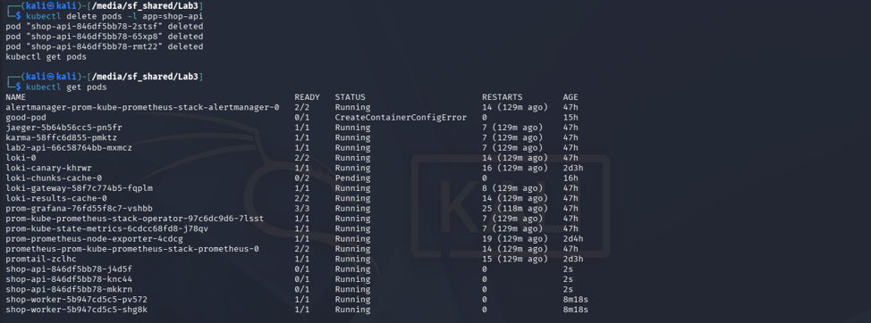

Видим, что все поды восстановились.


Меняем число реплик:

```bash
sed -i 's/replicas: 3/replicas: 5/' charts/shop/values.yaml
```

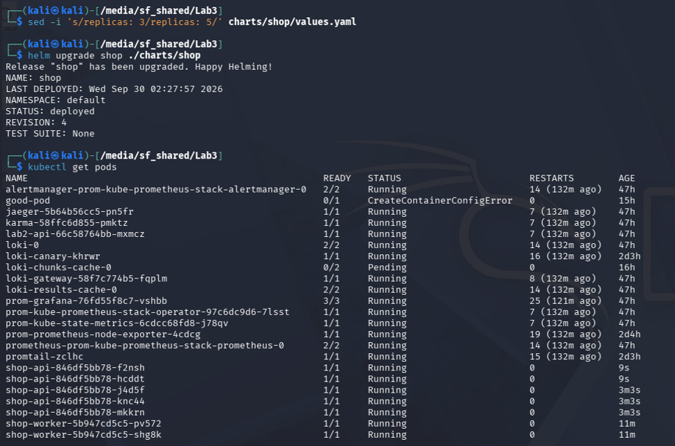

Видим, что количество реплик автоматически увеличилось до 5.


### Rolling update

Пробрасываем порт:

```bash
kubectl port-forward svc/shop-api 8080:80
```

И начинаем долбёжку в `/health`:

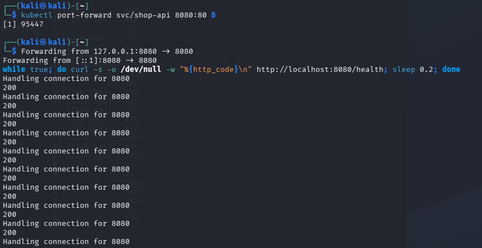

Поднимаем версию, апгрейдим и наблюдаем за curl:

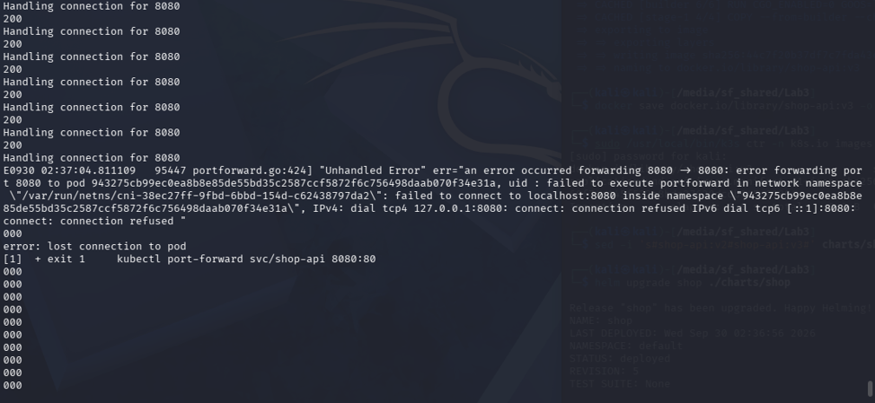

Видим, что что-то пошло не так. Вероятно, проброс портов оказался мёртв вместе с убитым подом, т.к. автоматического переключения на новый под нет. Чтобы правильно проверить rolling update, запускаем генератор нагрузки как под в кластере:

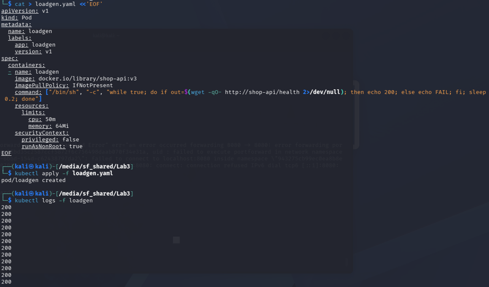

Видим стабильный поток ответов 200. Снова поднимаем версию:

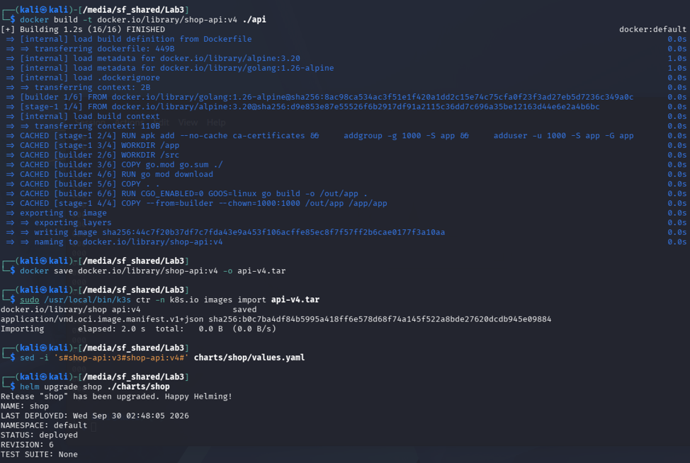
Видим:


Какие-то запросы провалились. Я сделал вывод, что натворил какую-то дичь, и начал заново.

Поднимаем прокси:

```bash
kubectl proxy
```

Цикл:

```bash
while true; do
  code=$(curl -s -o /dev/null -w "%{http_code}" \
    http://localhost:8001/api/v1/namespaces/default/services/shop-api:80/proxy/health)
  echo "$code"
  sleep 0.2
done
```

Поды:

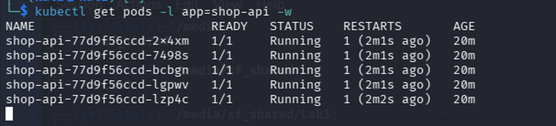

Заново собираем и поднимаем версию:

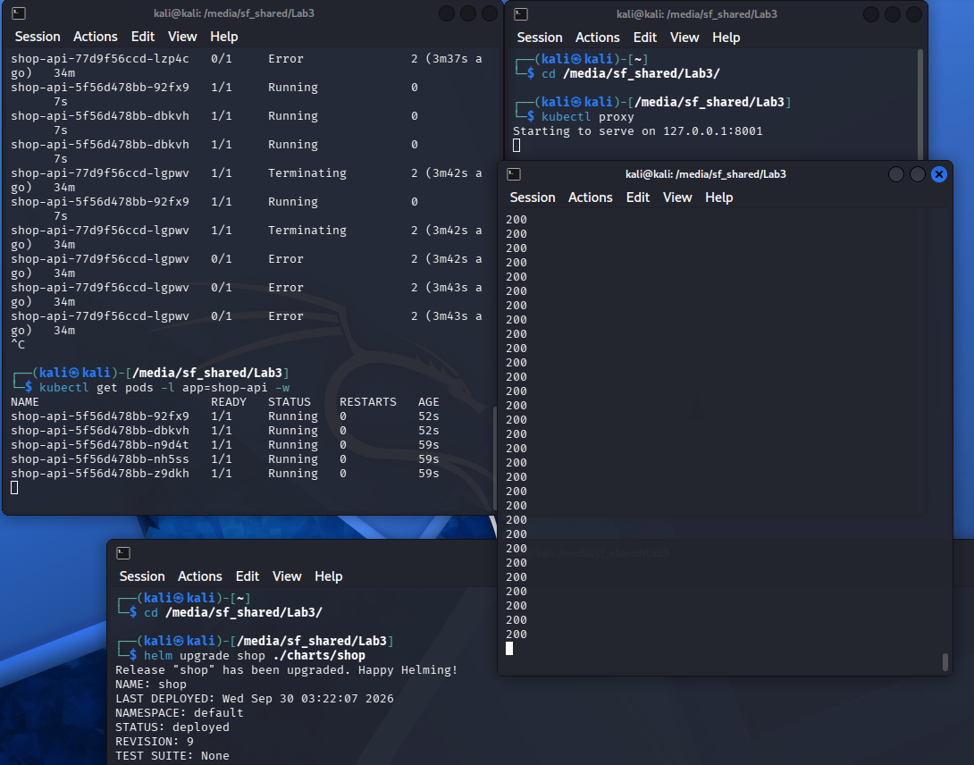

Видим, что поды рестартнулись, фэйлов нет, все ответы 200.

Тут видно, что поды умирают и запускаются не одновременно:

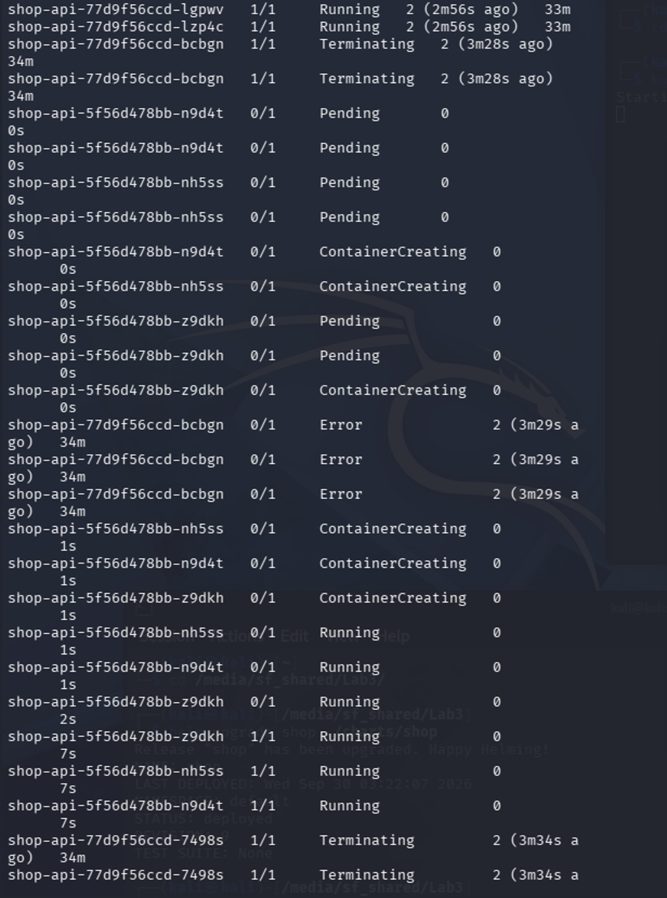

Это говорит о том, что rolling update работает и в любой момент времени есть работающие поды.

### Сломанная версия и rollback

Выставляем api переменную `HEALTH_FAIL=true` и апгрейдим.

Видим:

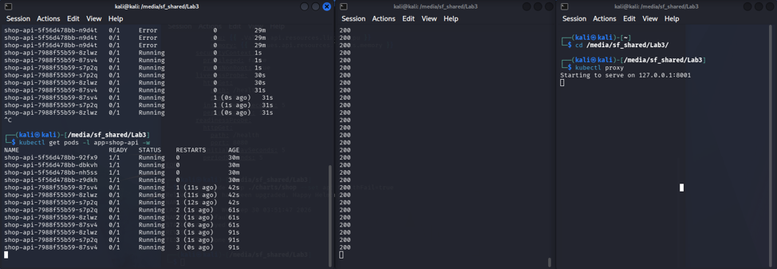

Поды не обновляются, но сервис продолжает всё время отвечать, потому что из пяти старых подов убит только один.

Откатываем обратно:

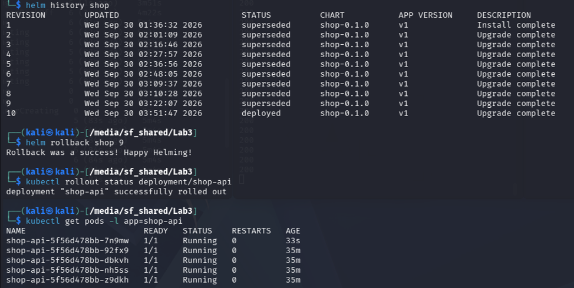

Видим, что все пять подов на месте.

## Часть 3. Postgres через оператор CloudNativePG

Разворачиваем оператор БД **CloudNativePG**. Проверяем работу:

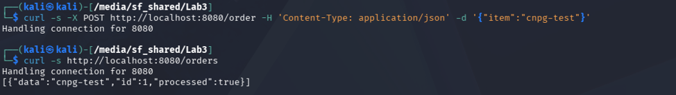

Пробуем удалить под postgres и проверить, вернёт ли его оператор. Список текущих подов:

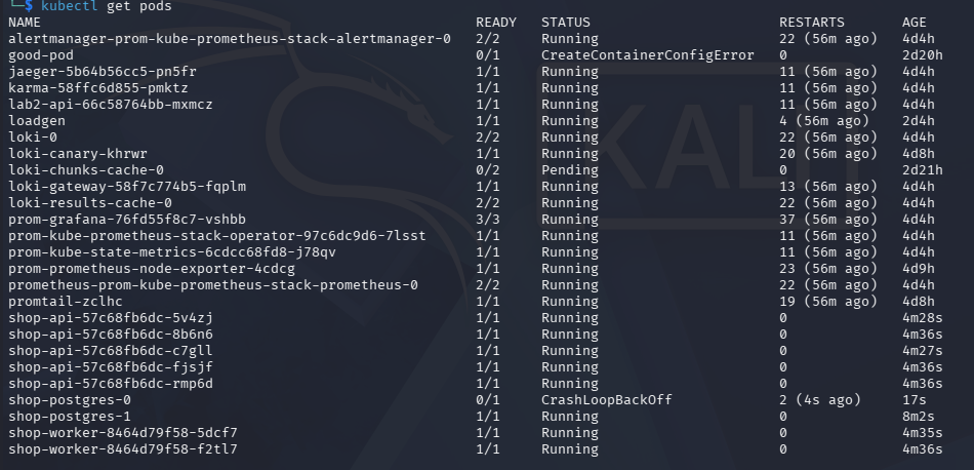

Удаляем под postgres:

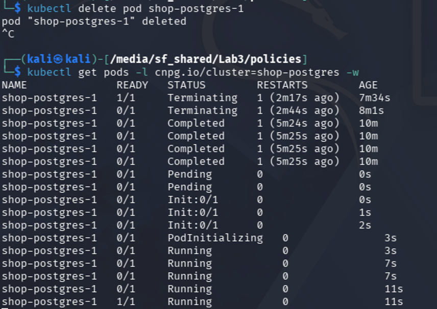

Видим, что оператор его вернул.


### Чем оператор отличается от controller-manager

**kube-controller-manager** — это набор встроенных контроллеров Kubernetes (ReplicaSet, Deployment, StatefulSet, Job). Они понимают только стандартные ресурсы API и обеспечивают базовую reconciliation-логику: «должно быть N реплик — держи N реплик». Если под умер, ReplicaSet создаст новый. Но controller-manager не знает специфики приложений: он не умеет делать backup PostgreSQL, не умеет переключать primary при failover, не умеет управлять репликацией или миграциями схемы.

**Оператор (CloudNativePG)** — это специализированный контроллер, который понимает кастомный ресурс `Cluster` (CRD) и знает про PostgreSQL всё. Из одного объекта `Cluster` он создаёт и поддерживает:

1. поды инстансов (StatefulSet под капотом);
2. PVC для данных;
3. сервисы (`-rw` для записи, `-ro` для чтения, `-r` для реплик);
4. секреты с CA и TLS-сертификатами;
5. PodDisruptionBudget;
6. репликацию, failover, backup.

Оператор постоянно смотрит на `spec` (желаемое состояние) и `status` (наблюдаемое состояние) и гонит фактическое к желаемому. Если primary упал — оператор сам выберет новый primary из реплик (если их больше одной), обновит `currentPrimary` в status и переключит трафик на `-rw` сервис. Controller-manager так не умеет — он просто пересоздаст упавший под, но не знает про роли в PostgreSQL.

**Главное отличие:** controller-manager универсальный и работает с любыми подами одинаково. Оператор — специализированный, знает предметную область конкретного приложения и автоматизирует операционную рутину (backup, failover, scaling), которую иначе делал бы инженер вручную.

## Часть 4. Отказ control plane

Останавливаем k3s, чтобы доказать, что control plane работать не будет, но при этом сервис продолжит работать.

Сначала убеждаемся, что всё работает до эксперимента:

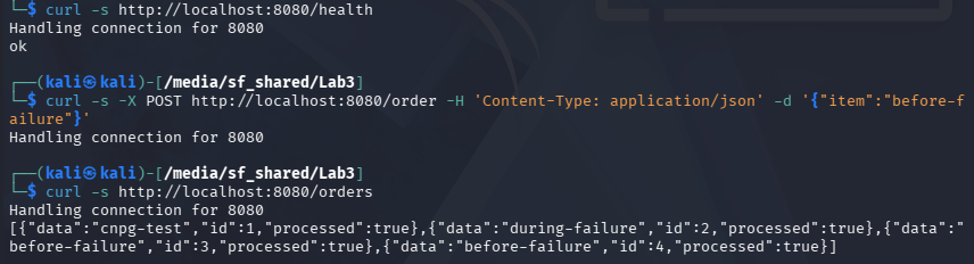

Включаем NodePort:

```bash
kubectl patch svc shop-api -p '{"spec":{"type":"NodePort"}}'
```

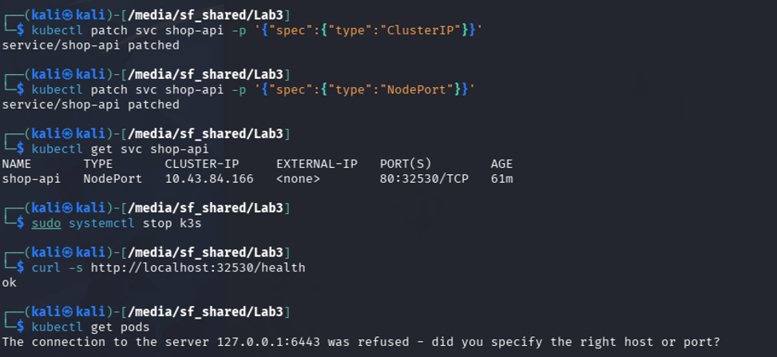

Останавливаем k3s:

```bash
sudo systemctl stop k3s
```

Видим, что control plane не работает (`kubectl get pods` → connection refused), а сервис отвечает (`curl` на NodePort → ok).

Возвращаем control plane:

```bash
sudo systemctl start k3s
```

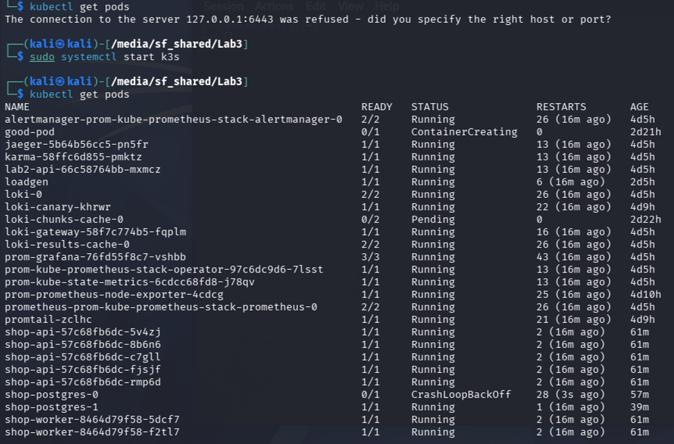

Видим, что всё снова работает.

## Часть 5. Мониторинг

Добавим мониторинг в эту лабу, используя стек из лабы 2 (часть стека – логи и трейсы не нужны).
Чтобы показать хотя бы одно сработавшее правило, добавим stateful postgres, который не поднимется, и увидим:

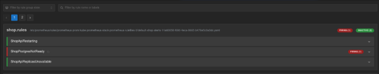

Промитиус зафиксировал неработоспособность пода.
Собираем дашборд (метрики: рестарты, состояние постгреса и доступные реплики api):

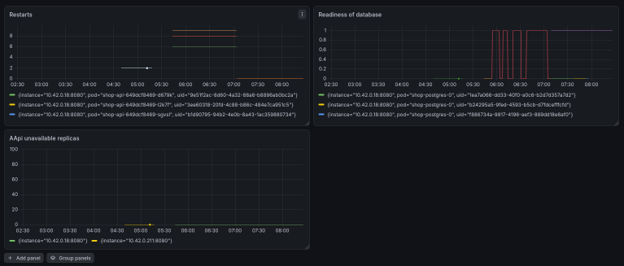

Видим графики для метрик 
