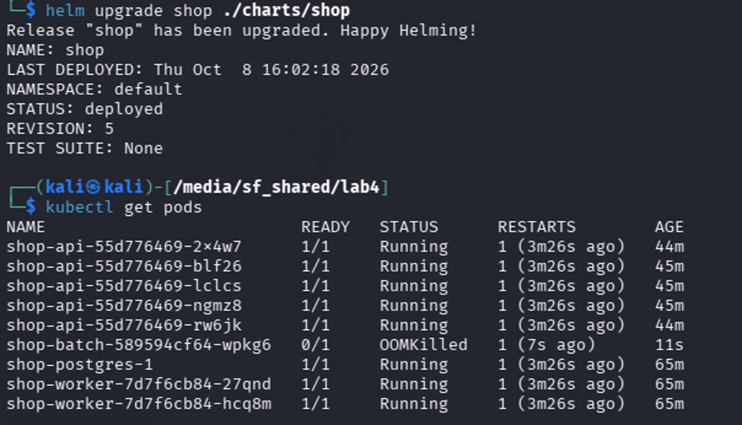
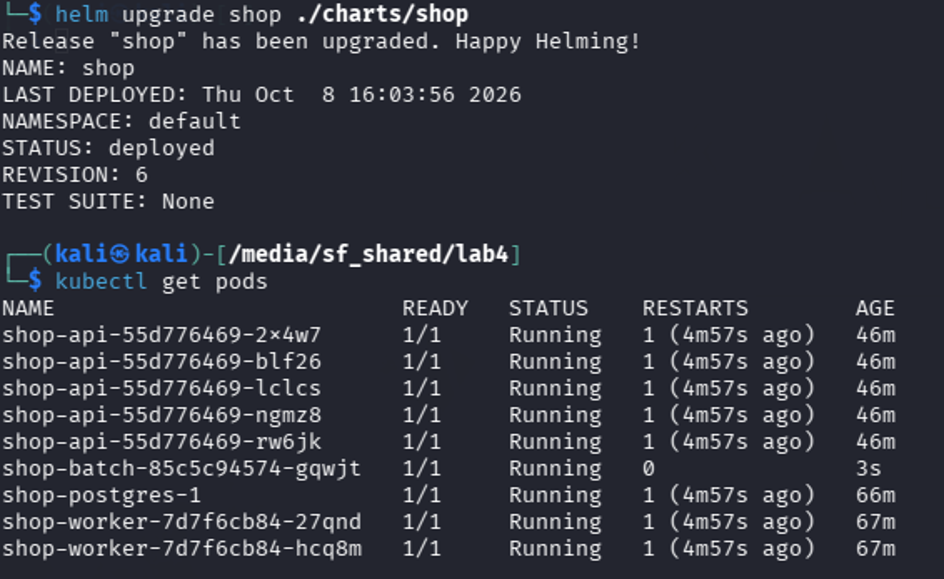
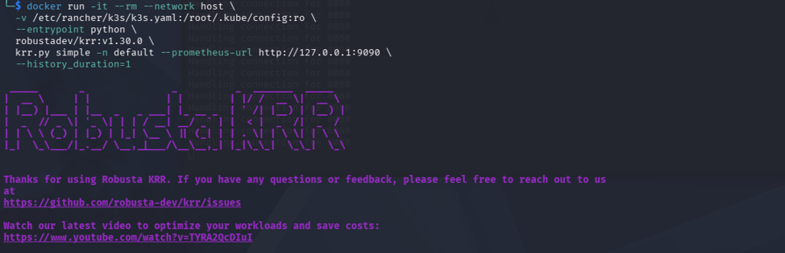
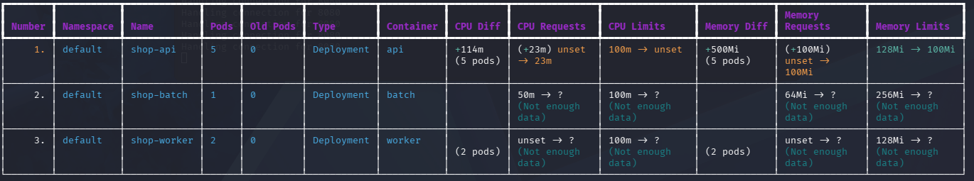
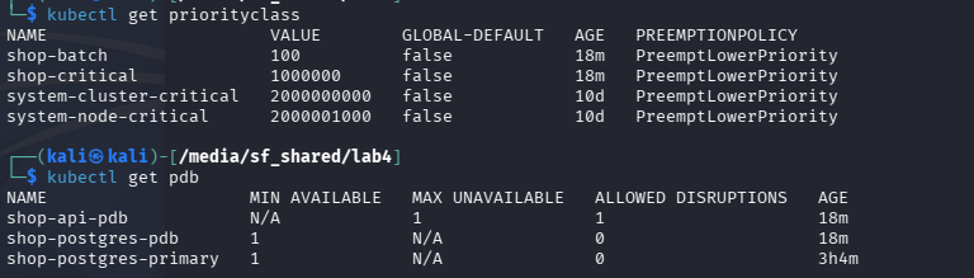
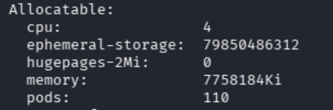
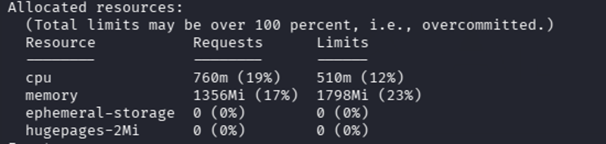
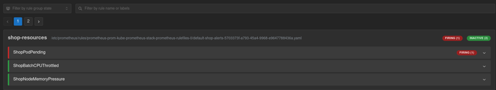
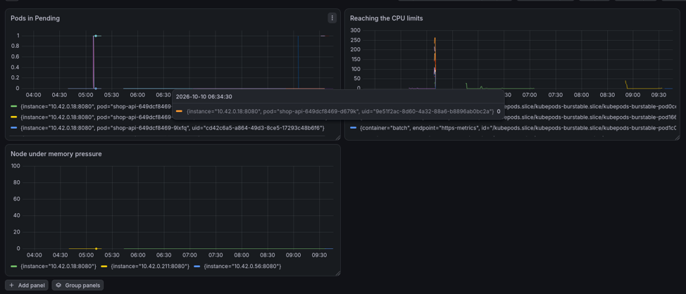

# Лабораторная 4. Ресурсы, планирование и отказоустойчивость

## Часть 0. Образ batch

```bash
docker build -t docker.io/library/shop-batch:v1 ./batch
docker save docker.io/library/shop-batch:v1 -o batch.tar
sudo /usr/local/bin/k3s ctr images import batch.tar
```

k3s работает со своим containerd, а не с docker, поэтому образ сначала сохраняется в tar через `docker save`, а затем импортируется в containerd кластера через `k3s ctr images import`.

## Часть 1. Pod Anti-Affinity vs Topology Spread Constraints

| Критерий | Pod Anti-Affinity | Topology Spread Constraints |
|---|---|---|
| Цель | Избежать colocation двух одинаковых подов | Равномерное распределение по топологии |
| Гибкость | Бинарно: либо на разных нодах, либо не работает | Позволяет контролировать степень неравномерности через maxSkew |
| Масштабирование | При 3 репликах и 2 нодах — одна нода получит 2 пода, другая 1 | При 3 репликах и 2 нодах — гарантирует maxSkew=1 (2+1) |
| Использование | Простой запрет "не сажай вместе" | Более тонкий контроль "распредели равномерно" |
| Когда выбирать | Когда нужно просто избежать единой точки отказа | Когда нужно оптимальное распределение нагрузки по нодам |

Я выбрал **Topology Spread Constraints**.

Обоснование:

1. **Гибкость:** maxSkew позволяет контролировать допустимую неравномерность распределения.
2. **Масштабируемость:** лучше работает при росте числа реплик и нод.
3. **Современность:** TSC — более новый и рекомендуемый механизм в Kubernetes.
4. **Практичность:** в продакшене чаще нужно именно равномерное распределение, а не просто "не вместе".

## Часть 2. batch в чарте и OOMKill

Добавил batch новым шаблоном в чарт shop, с requests/limits аналогичными api и worker:



Под batch был убит (OOMKilled): потребление памяти превысило limit 128 MiB, и cgroup завершил процесс. Увеличил лимит до 256 MiB и проверим:



Видим, что все в порядке.

## Часть 3. Prometheus и рекомендации krr

Поставил в кластер Prometheus (kube-prometheus-stack) и создал в чарте `servicemonitor.yaml`:

```bash
helm install prom prometheus-community/kube-prometheus-stack \
  --namespace monitoring --create-namespace \
  --set prometheus.prometheusSpec.serviceMonitorSelectorNilUsesHelmValues=false
```

Создал нагрузку на api:

```bash
kubectl port-forward svc/shop-api 8080:80 &
sleep 2
(while true; do
  curl -s -o /dev/null http://localhost:8080/health
  curl -s -o /dev/null -X POST http://localhost:8080/order -H 'Content-Type: application/json' -d '{"item":"load-test"}'
  sleep 0.2
done) &
```

Установил krr и запустил его по собранным метрикам:





Видим, что krr все посчитал для api и рекомендует не устанавливать лимиты по процессору, лимит памяти рекомендует снизить со 128МиБ до 100 МиБ. По worker и batch данных для рекомендации не хватает.
Вероятно, рекомендация с отсутствием лимита для процессора связана с тем, что в период нагрузок api упирается в лимит и тормозит. Лимит на память же нужен, чтобы в случае большой загрузки был убит процесс, а не вся нода.


## Часть 4

Не справился.

## Часть 5. PriorityClass, PodDisruptionBudget и QoS

Шаблон PriorityClass:

```yaml
{{- if .Values.priorityClasses.enabled }}
apiVersion: scheduling.k8s.io/v1
kind: PriorityClass
metadata:
  name: {{ .Release.Name }}-critical
value: {{ .Values.priorityClasses.critical.value }}
globalDefault: false
description: "Priority for critical path services (api, postgres)"
---
apiVersion: scheduling.k8s.io/v1
kind: PriorityClass
metadata:
  name: {{ .Release.Name }}-batch
value: {{ .Values.priorityClasses.batch.value }}
globalDefault: false
description: "Priority for background batch jobs"
{{- end }}
```

Создал шаблон PodDisruptionBudget (`shop-api-pdb`, `shop-postgres-pdb`). (скриншот)

Обновил шаблоны деплойментов api, worker и batch: добавил `priorityClassName`, обновил values. Проверил:



Как это работает. PriorityClass: shop-critical = 1000000, shop-batch = 100. Два разных сценария давления:

1. **Preemption (планировщик).** Высокоприоритетный под не влезает на ноду — планировщик выгоняет поды с меньшим value, чтобы освободить место по requests. При нехватке CPU/памяти batch (100) будет вытеснен ради api/postgres (1000000).
2. **Eviction (kubelet).** При реальном дефиците ресурсов на ноде kubelet среди кандидатов на вылет сначала смотрит на QoS-класс, а внутри класса — на приоритет: ниже приоритет → умирает раньше.

QoS-классы:

1. api, worker, postgres: requests = limits → Guaranteed. Потребление предсказуемо, kubelet вытесняет их последними.
2. batch: requests < limits → Burstable. Может разгоняться до limits, когда на ноде свободно, но под давлением жертвуется раньше Guaranteed.

PodDisruptionBudget защищает только от добровольных прерываний: drain ноды, апгрейд кластера, ручные evict через Eviction API. `shop-api-pdb` (maxUnavailable 1) не даст убрать сразу все 5 реплик при обслуживании; `shop-postgres-pdb` (minAvailable 1) при одной реплике запрещает трогать базу вообще. Важно: при недобровольном eviction из-за нехватки памяти kubelet PDB не уважает — там работают только QoS и приоритеты. Поэтому PDB и priorityClass решают разные задачи и нужны оба.

Порядок вытеснения при давлении по памяти (Burstable vs Guaranteed):

1. **BestEffort** (нет requests и limits) — первые;
2. **Burstable** — вторые; внутри класса раньше умирает тот, кто сильнее превысил свои requests по памяти (и у кого ниже приоритет);
3. **Guaranteed** — последние; вытесняются, только если сами превысили свои limits или если выметание всех остальных не спасло ноду.

Наш batch — Burstable с низким приоритетом, поэтому при memory pressure уходит первым по двум признакам сразу: класс и приоритет. Критический путь — Guaranteed с высоким приоритетом — остаётся работать. В этом и смысл приоритетов: eviction должен забрать batch, а не api.

## Часть 6. Давление по ресурсам и инцидент с Kyverno

Посмотрел, сколько ресурсов на ноде занято и сколько всего доступно:



Занято: 



Видим, что 6220Мб памяти 2300 4 ядра CPU (4000m). Под batch имеет request в 64 Миб и 10m.

Чтобы упереться в лимит по CPU, взял с запасом 70 реплик: суммарные requests 70 × 50m = 3500m почти выбирают все 4000m ноды, а суммарные limits 70 × 100m = 7000m гарантируют overcommit и троттлинг.

```yaml
resources:
  requests:
    cpu: 50m
    memory: 64Mi
  limits:
    cpu: 100m
    memory: 256Mi
```

После этого виртуальная машина зависла, и после каждого перезапуска зависала намертво через ~20 секунд после включения. За эти 20 секунд удалось выяснить причину: Kyverno лежит, а его validating webhook всё ещё зарегистрирован в API-сервере, поэтому любой запрос к API, попадающий под его правило, отправляется на мёртвый сервис и падает с InternalError. В это двадцатисекундное окно я снёс вебхуки Kyverno и отключил все поды.

Как делать эту часть и части 7–8 — не понял.

## Часть 9. Алерт на неготовый под

Создал под, который заведомо не может подняться, и посмотрел в Prometheus: алерт перешёл в firing, под не поднялся.



Дашборд:

