# Лабораторная 5. Сети Kubernetes, NetworkPolicy и сетевая наблюдаемость

## Часть 0. Выбор CNI

Выбран **Cilium**.

Главная причина — **Hubble**. В Части 6 нужно найти скрытую поломку связности «по карте трафика, а не подбором». Hubble — визуализатор трафика: показывает, кто к кому обращается, что заблокировано и почему пакет дропается. Без него Часть 6 превратилась бы в гадание. Cilium включает Hubble из коробки.

Дополнительно: Cilium работает на eBPF (быстрее iptables), поддерживает L7-политики (фильтрация по HTTP-путям), у него отличная документация.

Кластер k3s, Cilium ставился через Helm.

## Часть 1. Плоская сеть: как под получает сеть

Заглядываем под капот плоской сети: поды видят друг друга напрямую по IP, абстракция `Service` появляется выше.

Смотрим внутрь пода `shop-api`:

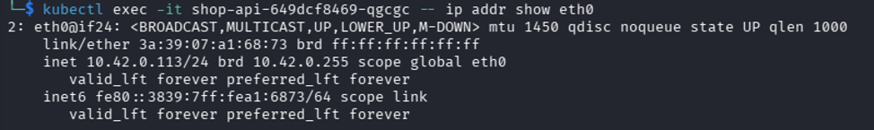

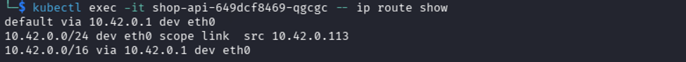

Парный конец veth на ноде:

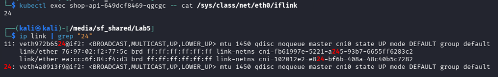

Пинг между подами по IP:

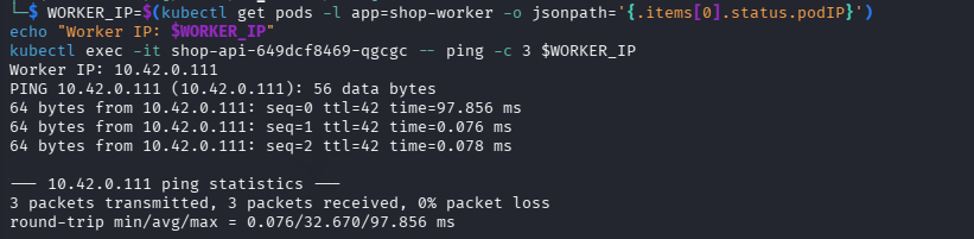


Вывод: сеть по умолчанию плоская, поды ходят друг к другу напрямую по IP. Именно поэтому `NetworkPolicy` нужна отдельно — без неё «любой может ходить к любому».

## Часть 2. NodePort и непрерывность сервиса при хаосе подов

### Зачем именно NodePort

Клиенту нужна стабильная точка входа, которая переживает смерть подов.

`ClusterIP` живёт только внутри кластера — снаружи (с хоста VM, откуда гоняется нагрузка и снимается график) до него не достучаться. `NodePort` открывает порт на узле (диапазон 30000–32767), и kube-proxy разбрасывает трафик с него на живые endpoints сервиса. Когда под `api` умирает и пересоздаётся с новым IP, NodePort-точка не меняется — меняется только набор backend'ов за ней. Это и есть механизм непрерывности, который доказываем ниже.

`LoadBalancer` не нужен: в on-prem/k3s он требует внешнего LB-контроллера (MetalLB) и в итоге всё равно проксирует на NodePort. Headless-сервис (`clusterIP: None`) вообще не даёт VIP: DNS отдаёт список IP подов напрямую, клиент сам балансирует и под хаосом закэширует мёртвый IP. Поэтому точка входа — NodePort.

Перед хаос-тестом фиксируем, что `shop-api` доступен через NodePort 30080:

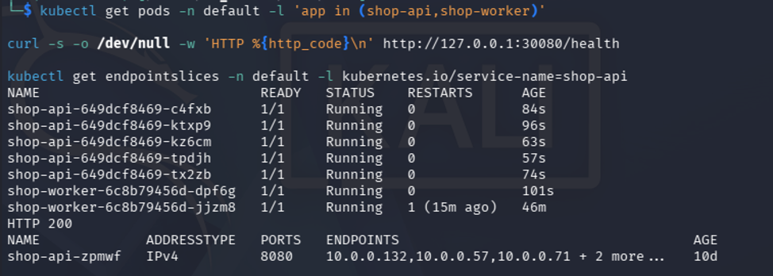

Цепочка DNAT — один хоп, а не два: kube-proxy переписывает destination сразу в `podIP:8080`. `Service.port: 80` — логический порт сервиса и ключ правила, а не промежуточный адрес в пакете. Поэтому `NetworkPolicy` на входе в под видит порт `8080`, и в ingress-политике API указан именно он, а не `30080` и не `80`.

### Режим kube-proxy

```bash
kubectl -n kube-system get cm kube-proxy -o jsonpath='{.data.config\.conf}' | grep -i 'mode:' || echo 'no explicit mode in configmap'
sudo iptables-save | grep -c '^-A KUBE-'
command -v ipvsadm || echo 'ipvsadm not installed'
kubectl exec -n kube-system ds/cilium -- cilium status | grep -i KubeProxyReplacement
```

Результат:

```text
no explicit mode in configmap
140
ipvsadm not installed
KubeProxyReplacement: False
```

Вывод: kube-proxy работает в режиме **iptables**, IPVS не используется, Cilium KubeProxyReplacement отключён. Разница iptables/IPVS заметна только на крупных кластерах: тысячи сервисов и endpoints, частые изменения EndpointSlice, высокий RPS — там важны скорость хеш-поиска и алгоритмы балансировки IPVS. На одноузловом учебном кластере оба режима одинаково корректно делают L4-балансировку `Service → Pod`.

### Хаос-тест

Скрипт `chaos.sh` в фоне убивает случайные поды `api`/`worker`; параллельно `load-client` гонит постоянную нагрузку на сервис по DNS-имени:

```bash
rm -f chaos.log load.csv
python3 -c 'import matplotlib' 2>/dev/null || pip install -q matplotlib --break-system-packages
kubectl apply -f load-client.yaml
kubectl rollout status deploy/load-client --timeout=60s
timeout 60 ./chaos.sh &
timeout 60 kubectl logs -f deploy/load-client > load.csv
wait
kubectl delete deploy load-client --ignore-not-found
python3 plot.py
ls -la continuity.png chaos.log load.csv
```

Результат:

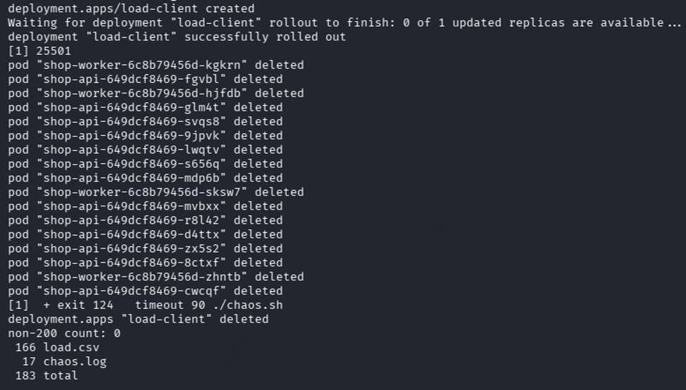

### Почему клиент не заметил смерть подов

Здесь связаны четыре сущности:

1. **DNS** — клиент обращается к `shop-api`, а не к IP пода.
2. **Service** — DNS отдаёт стабильный ClusterIP сервиса; NodePort даёт стабильную внешнюю точку на узле.
3. **EndpointSlice** — контроллер Kubernetes обновляет список живых backend-IP: убирает удалённые поды, добавляет новые после готовности.
4. **kube-proxy / iptables** — правила на ноде перенаправляют трафик с Service/NodePort только на актуальные живые endpoints.

Главная мысль: клиент не привязан к поду, он привязан к абстракции `Service`. Readiness probe не пускает трафик на под до готовности, graceful termination даёт старому поду дозавершить соединения.

## Часть 3. Целевая матрица доступа

Прежде чем запрещать, проектируем матрицу: кто к кому должен иметь доступ и кто — нет.

| Откуда | Куда | Доступ |
|---|---|---|
| Внешний клиент / NodePort | `shop-api` | да, TCP 8080 внутри пода |
| `load-client` | `shop-api` | да, TCP 8080 |
| `shop-api` | PostgreSQL | да, TCP 5432 |
| `shop-worker` | PostgreSQL | да, TCP 5432 |
| Посторонний pod | PostgreSQL | нет |
| Посторонний pod | `shop-api` | нет |
| PostgreSQL | Kubernetes API | да, TCP 443/6443 |
| Все рабочие pod'ы | CoreDNS | да, UDP/TCP 53 |
| Kubelet / node | App probes | да, probe-порты |
| Kubelet / node | Postgres probes | да, TCP 8000 |
| Prometheus | api metrics | да, TCP 8080 |
| Prometheus | postgres metrics | да, TCP 9187 |
| Всё остальное | всё остальное | нет |

Ориентир: клиент → `api`, `api` → PostgreSQL, `worker` → PostgreSQL — можно; всё остальное, включая «посторонний pod → PostgreSQL», — нельзя. Отдельно учтены DNS (без него сервисы не находят друг друга по имени) и служебный egress CloudNativePG к Kubernetes API.

## Часть 4. Реализация матрицы через Helm-чарт

Матрица реализована шаблонами NetworkPolicy в чарте `shop` и включается значением `networkPolicy.enabled=true`:

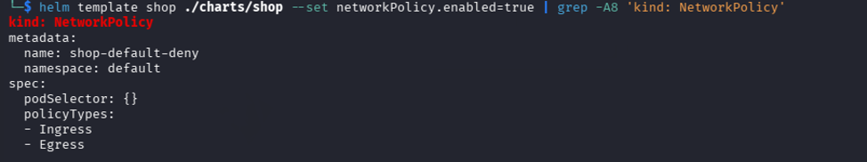


Созданные политики:

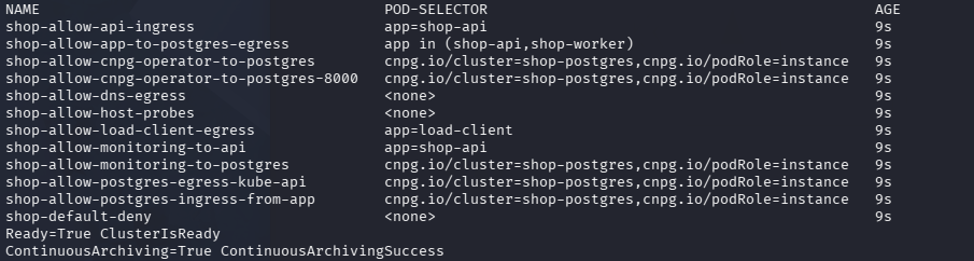

### `networkpolicy-default-deny.yaml` → `shop-default-deny`

Базовый запрет для namespace `default`: `podSelector: {}` выбирает все поды, `policyTypes: [Ingress, Egress]` без правил `ingress:`/`egress:` означает «ничего не разрешено». Фундамент zero-trust: Kubernetes по умолчанию открыт, поэтому сначала закрываем всё, а потом точечно открываем нужное. Все последующие политики работают как исключения из этого запрета.

### `networkpolicy-dns.yaml` → `shop-allow-dns-egress`

Разрешает всем подам namespace исходящий трафик к CoreDNS (`k8s-app: kube-dns` в `kube-system`) на UDP/TCP 53. Без неё default-deny egress сломал бы service discovery: поды не смогли бы резолвить `shop-postgres-rw`, `shop-api` и т.д. TCP 53 включён, потому что крупные DNS-ответы уходят по TCP, и без него часть запросов молча отваливается.

### `networkpolicy-api-ingress.yaml` → `shop-allow-api-ingress`

Открывает точку входа клиента в поды `app: shop-api` на порт 8080. Два источника: внешний клиент через `ipBlock: 0.0.0.0/0 except 10.0.0.0/24` (снаружи пускаем, случайным подам внутри pod-сети — нет) и внутренний нагрузочный под `app: load-client`. Порт указан pod-ный (8080), а не NodePort 30080 и не Service 80, потому что NetworkPolicy применяется уже к поду, после DNAT.

### `networkpolicy-app-to-postgres.yaml` → `shop-allow-app-to-postgres-egress`

Разрешает подам `shop-api` и `shop-worker` исходящий трафик к подам PostgreSQL (`cnpg.io/cluster: shop-postgres`, `cnpg.io/podRole: instance`) на TCP 5432. Это половина маршрута «приложение → база»: сторона клиента. Destination выбран по pod-лейблам CNPG, а не по ClusterIP сервиса, потому что NetworkPolicy матчит конечные поды, а ClusterIP — виртуальный адрес, который kube-proxy трансформирует в pod IP.

### `networkpolicy-postgres-ingress.yaml` → `shop-allow-postgres-ingress-from-app`

Вторая половина того же маршрута: разрешает подам PostgreSQL принимать входящий TCP 5432 от `shop-api` и `shop-worker`. Нужна отдельной политикой, потому что NetworkPolicy — allowlist по направлениям: egress со стороны клиента без ingress со стороны сервера соединение не пропустит. Пара этих файлов и формирует двусторонне открытый путь к базе.

### `networkpolicy-postgres-egress-api.yaml` → `shop-allow-postgres-egress-kube-api`

Разрешает подам PostgreSQL исходящий трафик к Kubernetes API (`10.43.0.1:443` и `10.0.2.15:6443`). Это нужно instance-manager'у CloudNativePG внутри пода: он читает Cluster, секреты и ConfigMap, обновляет статус инстанса, участвует в координации primary/replica. Без этого маршрута default-deny egress сделает PostgreSQL процессно живым, но неуправляемым оператором: статус перестанет сходиться, failover не сработает.

### `networkpolicy-host-probes.yaml` → `shop-allow-host-probes`

Разрешает kubelet'у с IP узла (`10.0.2.15/32`) входить во все поды namespace. Правило намеренно без `ports` — все порты с этого источника, — чтобы не заблокировать startup/readiness/liveness-пробы, включая HTTP-пробы CNPG на 8000: если probes упадут под default-deny ingress, поды перестанут становиться Ready или начнут перезапускаться. В production правило стоит сузить до конкретных probe-портов; здесь оно широкое осознанно, чтобы не ловить ложные поломки.

### `networkpolicy-monitoring-api.yaml` → `shop-allow-monitoring-to-api`

Разрешает Prometheus из namespace `monitoring` входить в поды `shop-api` на TCP 8080 (метрический эндпоинт для ServiceMonitor). Закладывается заранее: иначе в Части 7 скрейпинг метрик API выглядел бы как «скрытая поломка связности», хотя на деле это просто незакрытая строка матрицы.

### `networkpolicy-monitoring-postgres.yaml` → `shop-allow-monitoring-to-postgres`

Аналогично для базы: разрешает namespace `monitoring` входить в поды PostgreSQL на TCP 9187 — порт метрик CNPG/postgres exporter. Без него наблюдаемость базы после включения default-deny теряется.

## Часть 5. Итоговая матрица «ожидаемо / фактически»

Матрица сведена из Части 3 и проверена вживую при `networkPolicy.enabled=true`. Базовая политика `shop-default-deny` запрещает весь трафик в namespace `default`; разрешающие политики и две `CiliumNetworkPolicy` открывают только маршруты из матрицы. Полный список применённых политик зафиксирован в `lab5/part5-matrix-check.txt`.

Создаём посторонний pod и запускаем проверку:

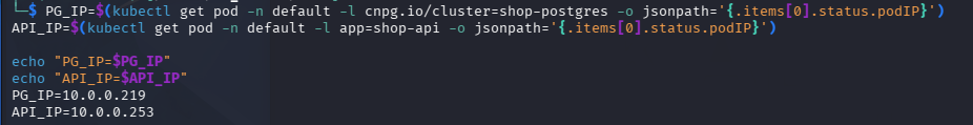

Результат:

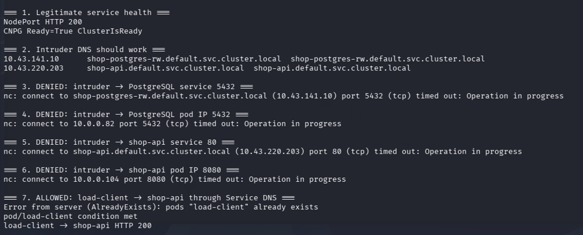

### Разрешённые маршруты

| Маршрут | Ожидаемо | Фактически | Чем подтверждено |
|---|---|---|---|
| Внешний клиент (хост) → NodePort 30080 → `shop-api`:8080 | allow | ✅ HTTP 200 | `curl http://127.0.0.1:30080/health` |
| `load-client` → `shop-api` по DNS | allow | ✅ HTTP 200 | `kubectl exec load-client -- curl http://shop-api/health` |
| `shop-api` → PostgreSQL:5432 | allow | ✅ | прямая проверка `nc`/`/dev/tcp` из api-пода (`part5-allowed-direct.txt`); косвенно — CNPG `Ready=True` + `NodePort 200` |
| `shop-worker` → PostgreSQL:5432 | allow | ✅ | прямая проверка из worker-пода; косвенно — приложение обрабатывает задачи из БД |
| PostgreSQL → Kubernetes API:443/6443 | allow | ✅ | `instance-manager` чист 30s (`pg-api-live-check.txt`), CNPG `Ready=True`, архивация WAL работает |
| Все pod'ы `default` → CoreDNS:53 | allow | ✅ | поды резолвят имена и становятся `Ready` при включённом default-deny; прямое `getent` из api-пода |
| Kubelet/node → probes (`api`/`worker`:8080, `postgres`:8000) | allow | ✅ | все поды `1/1 Running` при default-deny; иначе probes дропались бы и поды были бы `0/1` |
| Prometheus → `shop-api`:8080 (метрики) | allow | ✅ | Hubble flow: `monitoring/prometheus... -> default/shop-api:8080 FORWARDED`; в Части 7 скрейп api отключён, так как приложение не отдаёт `/metrics` |
| Prometheus → PostgreSQL:9187 (метрики) | allow | ✅ | Hubble flow + Prometheus target `shop-metrics-postgres` в состоянии `up` (Часть 7) |

### Запрещённые маршруты (посторонний pod `netshoot`, namespace `intruder`)

| Маршрут | Ожидаемо | Фактически | Чем подтверждено |
|---|---|---|---|
| `intruder` → PostgreSQL service:5432 | deny | ✅ timed out | `nc shop-postgres-rw.default.svc.cluster.local 5432` |
| `intruder` → PostgreSQL pod IP:5432 | deny | ✅ timed out | `nc 10.0.0.82 5432` |
| `intruder` → `shop-api` service:80 | deny | ✅ timed out | `nc shop-api.default.svc.cluster.local 80` |
| `intruder` → `shop-api` pod IP:8080 | deny | ✅ timed out | `nc 10.0.0.104 8080` |
| Всё остальное → всё остальное | deny | ✅ | `shop-default-deny` покрывает остаток пространства |

IP pod'ов в таблице (`10.0.0.82`, `10.0.0.104`) эфемерны и зафиксированы на момент прогона; после пересоздания подов они меняются, что дополнительно доказывает абстракцию Service из Части 2.

### Негативный контроль: запрет — это не поломка DNS

Критично, что `netshoot` **успешно резолвил** имена перед попытками соединений:

```text
10.43.141.10    shop-postgres-rw.default.svc.cluster.local
10.43.220.203   shop-api.default.svc.cluster.local
```

Если бы DNS не работал, таймауты можно было бы ошибочно принять за поломку service discovery. Здесь DNS жив, а соединения режутся именно политиками. Hubble подтвердил, что это policy drop:

```text
intruder/netshoot -> default/shop-api:8080 Policy denied DROPPED
intruder/netshoot -> default/shop-postgres-1:5432 Policy denied DROPPED
```

### Почему таймаут, а не connection refused

`connection refused` означает «хост жив, порт не слушается»: ядро отвечает RST. Таймаут означает, что пакет уходит в «чёрную дыру» без быстрого отказа, — типичный признак дропа по NetworkPolicy/CNI. В прогоне легитимные маршруты давали `HTTP 200`/`FORWARDED`, запрещённые — таймаут и `DROPPED`: картина непротиворечива, сервисы живы, лишние пути закрыты политиками.

### Вывод

Разрешённое работает, запрещённое не проходит; посторонний pod не получает доступ к API и PostgreSQL, а `api` и `worker` к PostgreSQL — имеют; DNS работает, поэтому запрет не маскируется под поломку service discovery.

## Часть 6. Скрытая поломка связности и диагностика через Hubble

Поломка связности реализована не ручной правкой манифестов, а значением `networkPolicy.fault` в Helm-чарте `shop`. Три шаблона NetworkPolicy при `fault=none` рендерят корректные разрешения, а при определённом значении ломают ровно один маршрут:

- `fault=app-label` — egress-политика `app→postgres` начинает выбирать несуществующие лейблы `shop-apii`/`shop-workeri`;
- `fault=postgres-port` — ingress-политика PostgreSQL разрешает порт `5433` вместо `5432`;
- `fault=dns` — политика DNS-egress перестает рендериться вовсе.

Это позволяет случайно выбрать поломку скриптом и применить/снять её одним `helm upgrade`, не трогая остальные политики. Диагностика велась через локальный Hubble-сервер агента (Relay для одноузловой лабы не обязателен):

```bash
kubectl exec -n kube-system ds/cilium -c cilium-agent -- \
  hubble observe --server localhost:4244 --last 80 -o compact --print-policy-names
```

Базовое состояние (`fault=none`): соединение `fault-client → postgres:5432` проходит, и Hubble показывает маршрут, разрешённый с обеих сторон:

```text
EGRESS ALLOWED BY shop-allow-app-to-postgres-egress
INGRESS ALLOWED BY shop-allow-postgres-ingress-from-app
to-endpoint FORWARDED
```

Это эталон, с которым сравниваются все последующие дропы.

### Поломка 1 (`postgres-port`)

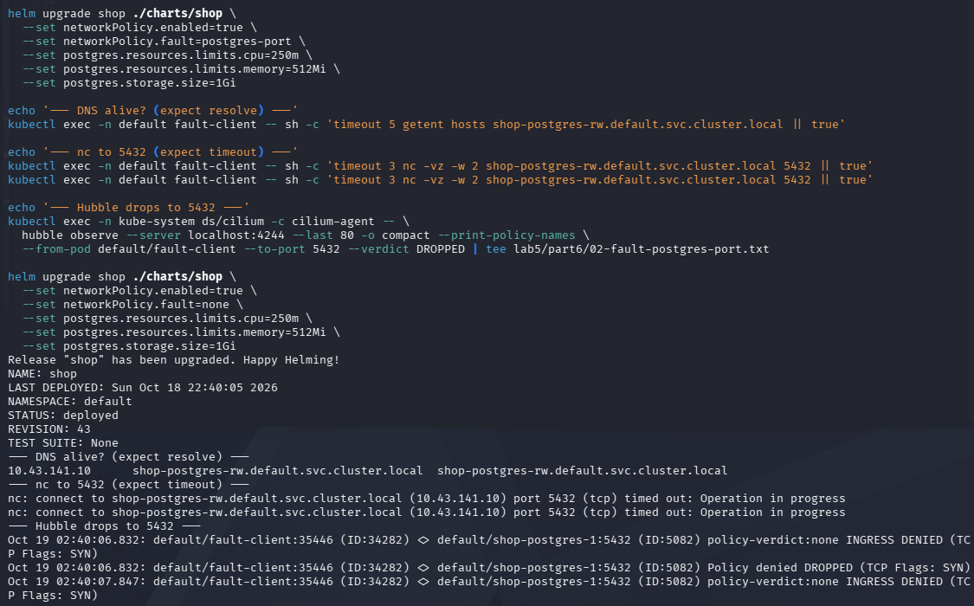


### Поломка 2 (`app-label`)

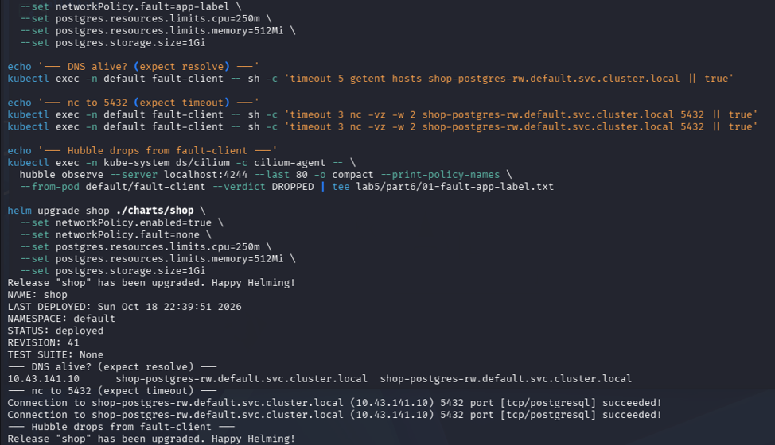

### Поломка 3 (`dns`)

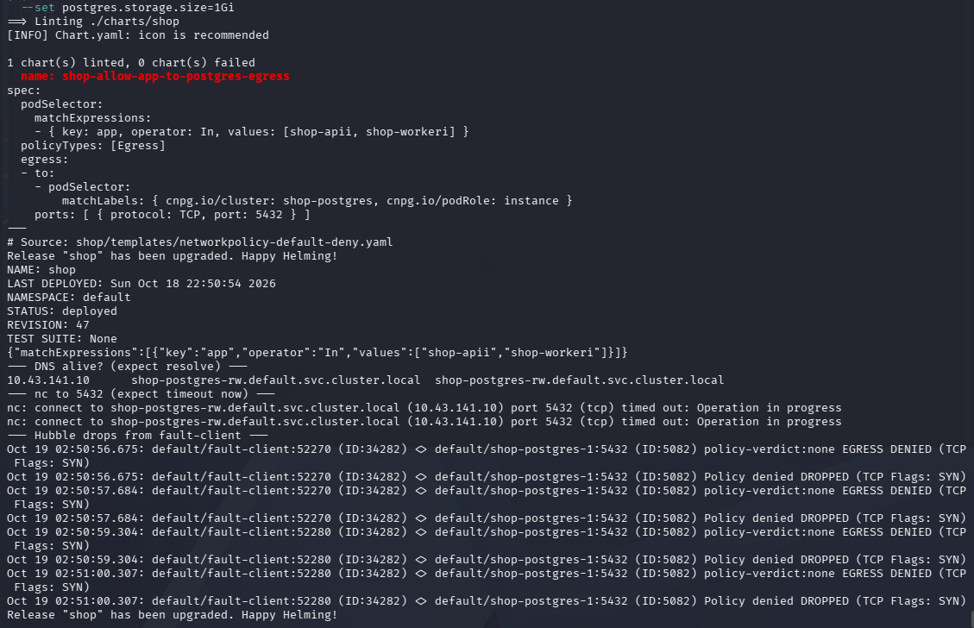

## Часть 7. Мониторинг: ServiceMonitor, PrometheusRule, алерты

Использован стек Лабы 2 (`kube-prometheus-stack`), новый не поднимался.


### Алерты

В чарт добавлен `PrometheusRule` с тремя правилами:

ShopPolicyDeniedTraffic: срабатывает, когда происходит любой дроп по политике за 2 минуты, т.е. нарушение zero-trust
ShopTCPConnectionDrops: срабатывает, когда больше 5 TCP дропов за 2 минуты
CoreDNSDownOrMissing: нет healthy scrape-цели CoreDNS 1 минуту.

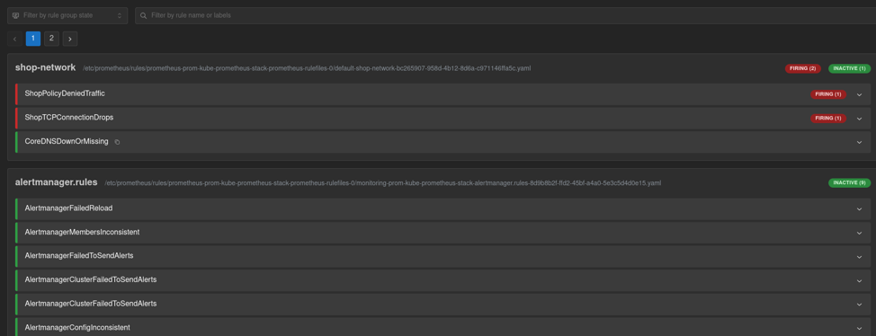