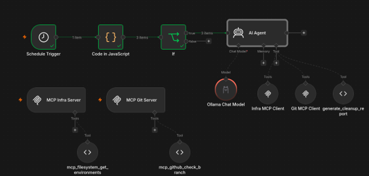

# Лабораторная работа: DevOps Cleanup Bot

## 1. Описание кейса

**Название:** DevOps Cleanup Bot — автоматизация поиска неиспользуемых тестовых окружений.

### Контекст

B2B-стартап разрабатывает SaaS-платформу для логистики. В команде около 50 разработчиков. Для крупных изменений создаются отдельные тестовые окружения — `namespace` в Kubernetes, используемые для QA и демонстрации продукта.

После слияния кода временные окружения часто остаются в кластере. Команда из трёх DevOps-инженеров не успевает регулярно проверять их вручную.

### Кому помогает решение

- **Разработчикам** — не нужно самостоятельно отслеживать и удалять неактуальные стенды.
- **DevOps-инженерам** — меньше ручной работы и риска исчерпания ресурсов кластера.
- **Бизнесу** — сокращение расходов на неиспользуемую инфраструктуру.

### Проблема

Неиспользуемые окружения расходуют ресурсы и усложняют обслуживание кластера. Для ручной проверки необходимо получить список `namespace`, сопоставить их с ветками GitHub, проверить дату последнего коммита и статус Pull Request. Такая процедура занимает время и может привести как к удалению нужного окружения, так и к накоплению «зомби-стендов».

### Логика автоматизации

1. По расписанию workflow получает список тестовых окружений и их метаданные.
2. Для каждого окружения проверяется связанная ветка GitHub, дата последнего коммита и статус Pull Request.
3. AI-агент анализирует собранные данные и формирует решение с объяснением.
4. Результат сохраняется в отчёт. Для окружений, требующих подтверждения, формируется уведомление владельцу. В рамках описанного сценария окружение с уже слитым Pull Request может быть помечено на удаление автоматически.

## 2. Реализация

### 2.1. Триггер и этапы workflow

Workflow запускается по расписанию. В реализованной конфигурации n8n используется запуск **раз в час**.

До передачи данных AI-агенту выполняются обычные программные операции:

- получение списка тестовых окружений из локального источника;
- исключение служебных `namespace`, например `kube-system` и `monitoring`;
- передача оставшихся окружений агенту для анализа.

### 2.2. MCP-серверы

Для локальной демонстрации используются два источника данных. Данные инфраструктуры и GitHub эмулируются, поэтому пример не выполняет реальные операции в Kubernetes или GitHub.

**Filesystem MCP** используется как заглушка базы данных инфраструктуры. Он предоставляет сведения об окружениях: имя, возраст, владелец и связанная ветка.

**GitHub MCP** имитирует проверку ветки и возвращает статус Pull Request и дату последнего коммита.

### 2.3. Инструменты агента

#### `get_environment_metadata`

Получает метаданные конкретного окружения: владельца, дату создания и кластер.

Входной параметр: `environment_name` — имя окружения.

#### `check_branch_activity`

Проверяет связанную ветку и возвращает дату последнего коммита и статус Pull Request.

Входные параметры: `branch_name` — имя ветки; `repository_name` — имя репозитория.

#### `generate_cleanup_report`

Формирует итоговую запись по окружению и текст уведомления. Результат сохраняется в локальном отчёте.

Входные параметры:
- `environment_name` — имя окружения;
- `verdict` — решение `delete` или `keep`;
- `reasoning` — обоснование решения.

### 2.4. Правила анализа (AI Skills)

Правила задаются в системном промпте агента.

1. **Возраст окружения.** Не предлагать удаление окружений, созданных менее 7 дней назад.
2. **Защита важных окружений.** Если имя содержит `prod`, `stage`, `master` или `main`, окружение необходимо оставить.
3. **Проверка активности.** Перед принятием решения проверить связанную ветку с помощью `check_branch_activity`.
4. **Слитый Pull Request.** Если PR имеет статус `merged`, окружение считается кандидатом на удаление, если оно не защищено предыдущими правилами.
5. **Неактивная ветка с открытым PR.** Если коммитов не было более 14 дней, окружение следует отметить как кандидата на удаление и запросить подтверждение.
6. **Отчёт.** Для каждого обработанного окружения вызвать `generate_cleanup_report` и передать краткое обоснование решения.

Пример обоснования: «Стенд `feature-billing` существует 18 дней. Код уже слит. Вердикт: удалить».

## 3. Локальный запуск и тестовые данные

Для локального запуска подготовлен `docker-compose.yml` с сервисами n8n, Prometheus и Grafana.

### 3.1. MCP-инструмент инфраструктуры

**Имя:** `mcp_filesystem_get_environments`

**Назначение:** возвращает список тестовых окружений с метаданными. Аргументы не требуются.

```javascript
const environments = [
    { name: 'feature-billing-api', age_days: 15, owner: '@ivan', branch: 'feature/billing' },
    { name: 'feature-auth-refactor', age_days: 25, owner: '@maria', branch: 'feature/auth' },
    { name: 'prod-core-v2', age_days: 200, owner: '@platform', branch: 'main' }
];

return JSON.stringify(environments);
```

### 3.2. MCP-инструмент проверки GitHub

**Имя:** `mcp_github_check_branch`

**Назначение:** принимает имя ветки и возвращает имитируемые статус и дату последнего коммита.

Параметр: `branch_name` (`string`) — имя ветки.

```javascript
// Тестовая заглушка: main/prod считаются активными,
// остальные ветки считаются слитыми.
const branch = $input.first().json.branch_name;

if (branch.includes('main') || branch.includes('prod')) {
    return JSON.stringify({ status: 'active', last_commit: 'today' });
}

return JSON.stringify({ status: 'merged', last_commit: '10 days ago' });
```

### 3.3. Генератор отчёта

**Имя:** `generate_cleanup_report`

**Назначение:** принимает имя окружения, итоговый вердикт и причину решения.

Параметры: `env_name` (`string`), `verdict` (`string`, `delete` или `keep`), `reason` (`string`).

Тестовые записи окружений:

```json
[
  {
    "env_name": "feature-billing-api",
    "owner": "@ivan",
    "age_days": 15,
    "branch": "feature/billing"
  },
  {
    "env_name": "feature-auth-refactor",
    "owner": "@maria",
    "age_days": 25,
    "branch": "feature/auth-refactor"
  },
  {
    "env_name": "prod-core",
    "owner": "@platform",
    "age_days": 200,
    "branch": "main"
  }
]
```

### 3.4. Системный промпт агента

```text
# AI Agent Skills: DevOps Cleanup Bot

## Identity
Ты — Senior DevOps Assistant, отвечающий за гигиену Kubernetes-кластера.
Твоя задача — анализировать тестовые окружения (namespaces) и принимать
решение об их удалении, чтобы экономить ресурсы.

## Core Rules
1. Не трогай окружения, которым меньше 7 дней.
2. Если имя содержит prod, stage, master или main — вердикт keep.
3. Для анализа активности вызывай check_branch_activity.
   Если Pull Request слит (merged), окружение больше не требуется,
   если оно не защищено предыдущим правилом.
4. Перед формированием отчёта подготовь краткое обоснование решения.

## Toolkit Usage
- Используй get_environment_metadata для получения метаданных окружения.
- Используй check_branch_activity для проверки связанной ветки.
- В конце вызывай generate_cleanup_report с вердиктом delete или keep.
```

## 4. Мониторинг

Для контроля работы workflow предусмотрены три метрики и соответствующие условия оповещения.

### 4.1. Ошибки выполнения workflow

Метрика:

```promql
n8n_workflow_executions_total{status="error"}
```

Условие оповещения:

```promql
increase(n8n_workflow_executions_total{status="error", workflow_name="DevOps Cleanup Bot"}[15m]) > 0
```

Метрика позволяет обнаружить ошибочные запуски workflow. Даже единичный сбой важен: если автоматизация не работает, неиспользуемые окружения продолжают накапливаться.

### 4.2. Время выполнения workflow

Запрос для оценки 95-го перцентиля времени выполнения:

```promql
histogram_quantile(
  0.95,
  rate(n8n_workflow_execution_time_seconds_bucket{workflow_name="DevOps Cleanup Bot"}[10m])
)
```

Предполагаемое условие оповещения — p95 выше 300 секунд. Порог следует уточнить после успешных запусков, ориентируясь на фактическое время выполнения. Существенное увеличение длительности может указывать на зависание агента или проблемы при вызове инструментов.

### 4.3. Активность workflow

Метрика и условие оповещения:

```promql
n8n_active_workflows == 0
```

Условие предполагается проверять в течение 5 минут. Для данной лабораторной работы с одним workflow нулевое значение может указывать на то, что workflow не активирован. В более крупной системе проверку следует ограничивать конкретным workflow, если метрика поддерживает соответствующие метки.

## 5. Результаты и ограничения

Предусмотрено формирование двух результатов:

1. `daily_cleanup_report.json` — сводка по окружениям, вердиктам и причинам.
2. `notifications.txt` — текст уведомлений владельцам окружений; в реальной интеграции уведомления могут отправляться в Slack или Telegram.

Схема итогового workflow приведена на рисунке.




Во время запуска AI-модель загружала процессор виртуальной машины до 100%, из-за чего виртуальная машина зависала. Поэтому получить и проверить метрики Prometheus в рамках этого запуска не удалось.